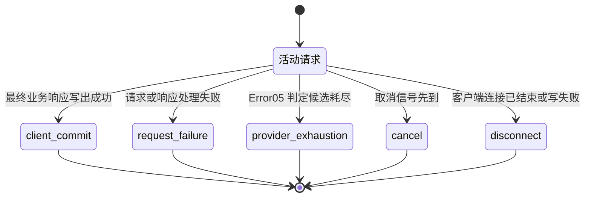

# Responses namespace shell roundtrip 生命周期

## 成功 DAG 边界

`responses-namespace-shell-roundtrip.graph.json` 只表达一次可执行成功的 shell roundtrip：

- 唯一输入是公开 Responses 首轮请求。
- 唯一输出是最终业务响应成功写出后的 `successful-roundtrip-disposition`。
- 13 个节点顺序可达，无回边、失败分类器或成功/失败聚合节点。
- `写出首轮工具调用` 与 `写出最终业务响应` 绑定同一个 Server writer owner
  `routecodex.v3.server.write_client_frame`。该 owner 的两次顺序调用分别交付首轮工具调用
  和最终业务响应；没有第二写 owner。
- `提交成功处置并释放请求资源` 只在最终 writer 成功返回后执行。它不写客户端业务字节，
  只产生 `client_commit` 成功处置并执行资源释放。

失败、取消、客户端断开和 provider exhaustion 不属于成功 DAG。DAGPipe 在节点失败时会
排空当前 wave 并停止后续 wave，因此静态图不能靠正常输出 ARC 模拟异常 ARC。runtime/server
外层边界负责把异常转换成 typed terminal receipt，成功 DAG 不承担异常分支。

## Typed terminal contract

一次请求的 terminal 只在下列五个互斥值中选择一个：

| terminal | 含义 | 唯一收口 |
| --- | --- | --- |
| `client_commit` | 最终业务响应已经成功写给客户端 | 成功 disposition，随后释放请求资源 |
| `request_failure` | 请求处理、归一化、投影、工具身份恢复、不可配对结果或响应处理在客户端最终提交前失败 | 关闭本请求 transport，释放请求与尝试资源 |
| `provider_exhaustion` | Error05 已判定没有剩余可执行 provider 候选 | 只关闭本请求 transport，不写 provider error、代理替代错误、SSE error 或正常空完成 |
| `cancel` | Runtime cancellation 在 terminal 前生效 | 关闭本请求 transport，释放请求与尝试资源 |
| `disconnect` | 客户端 transport EOF、error、drop 或最终写失败 | 停止本请求后续写入，释放已拥有资源 |

Runtime terminal finalizer 是该请求唯一 terminal 提交点。它使用 compare-and-set 或等价
原子状态转移，从活动状态进入上述一个 terminal。第一次成功提交 terminal 后，后续完成、
失败、cancel 或 disconnect 事件只能记录为诊断 observation，不能改写 terminal。

每个 terminal 生成一个 typed receipt。receipt 至少包含：

```text
request_id
execution_id
stage
terminal
source
transport_close
resources_released
```

`attempt_id` 只在事件属于具体 provider attempt 时存在。`source` 保留内部 typed source，
不得把 provider body、SSE error 或代理错误文本写入客户端。`resources_released` 列出实际
移交释放的资源身份。receipt 是内部 control evidence，不进入 request、provider 或 client
business payload。

## 互斥状态机



同一时刻出现多个终止信号时，以 terminal finalizer 第一次成功提交的状态为准。正常业务
响应不得触发 provider failure。Provider HTTP 或 error-channel 错误也不得成为
`client_commit` 输入。可恢复 provider 错误只结束当前 attempt；Error05 在目标内选择下一
候选时创建新的 attempt identity，不回到本状态机。

## 阶段到 terminal 的映射

| 可中止阶段 | terminal | 触发与收据 |
| --- | --- | --- |
| 接收首轮或后续请求 | `request_failure`，客户端断开时为 `disconnect` | 公共入口 framing、body 或接收失败产生 `stage=receive` receipt；不写客户端错误 payload |
| 保留请求与工具声明 | `request_failure` | 无损归一化失败产生 `stage=normalize` receipt；错误来源进入 typed Error evidence |
| 绑定声明与目标名称、关联后续历史身份 | `request_failure` | 标准投影或声明绑定失败产生 `stage=standard_projection` receipt；不猜身份或切换 provider 掩盖本地失败 |
| 首轮或后续 provider attempt | 候选耗尽时为 `provider_exhaustion`；仍有候选时不终止 roundtrip | Error05 耗尽决策产生 `stage=provider_recovery` receipt，记录唯一 provider attempt 链；仅关闭当前请求 transport |
| 还原客户端工具身份 | `request_failure` | inverse 或工具身份恢复失败产生 `stage=client_tool_projection` receipt；不发送伪造工具调用 |
| 写出首轮工具调用 | `disconnect` | transport 写失败或客户端关闭产生 `stage=first_client_write` receipt；已交付字节不撤回 |
| 客户端工具执行 | 无法形成配对结果时为 `request_failure`；可配对的执行错误结果继续业务路径 | 无配对结果产生 `stage=client_tool_execution` receipt；真实工具错误结果保留 call ID 和 output，作为业务内容继续转发 |
| 接收配对后续请求 | `disconnect` | roundtrip 在此结束前客户端 transport 已关闭，产生 `stage=paired_followup_receive` receipt |
| 写出最终业务响应 | `disconnect` | 最终 writer transport 失败或客户端已断开，产生 `stage=final_client_write` receipt；不得改写为 `client_commit` |
| 最终写前的响应序列化或成帧 | `request_failure` | 可表示业务内容处理失败产生 `stage=final_response_processing` receipt；不得写 provider error 或空成功 |
| 任意活动阶段发起 cancellation | `cancel` | cancellation receipt 记录 `stage=active_stage`；与 disconnect 竞争时由第一次 terminal 提交决定 |

可表示的业务响应，包括模型生成的无效工具参数和客户端返回的真实工具错误结果，不属于
provider failure 或本地 `request_failure`。它们应保持业务语义进入下一轮，让客户端和模型
自行纠正。只有无法形成可继续执行的配对结果时，本 roundtrip 才以 `request_failure` 收口。

## 资源与 effect

成功 DAG 的最终节点在 `resources.writes` 中声明释放或 drop 已登记资源。此处 `writes` 表示
资源 custody 结束和 terminal 状态写入，不表示修改业务 payload，也不把控制状态写回业务体。

| 资源 | effect | 责任 |
| --- | --- | --- |
| `v3.protocol_conversion.attempt_tool_binding` | 请求和每次 attempt 完成后释放 holder | 绑定 owner 创建，terminal cleanup 释放 |
| `v3.response.provider_raw` | 成功写出后或 terminal cleanup 时释放 provider raw | Runtime attempt scope |
| `v3.hub.response_semantic` | 最终客户端投影完成后或 terminal cleanup 时释放 | Runtime response scope |
| `v3.response.client_payload` | 最终 writer 完成后或 terminal cleanup 时释放 | Runtime/Server client delivery boundary |
| `v3.server.model_transport_outcome` | 写入本请求无响应或成功提交的 typed outcome | Server/Runtime terminal boundary |
| `v3.server.responses_session_admission` | 在 body EOF、error 或 drop 后释放 admission permit | Server Responses session boundary |
| `v3.front.request_activity_gate` | 在本请求 transport 完成、失败或断开后释放 activity permit | Server front transport boundary |

成功路径和所有 terminal 路径都必须释放本请求拥有的 attempt binding、provider/result
资源和请求局部 transport。`request_failure`、`provider_exhaustion`、`cancel` 与
`disconnect` 只影响当前请求及当前 owned transport，不关闭 aggregate server，不改变其他
请求，也不把内部状态写入客户端业务响应。

`client_commit` receipt 是成功写出和资源释放的唯一成功收据。静态图的
`successful-roundtrip-disposition` 只描述这一成功输出；它不证明 SDK compile、Operator
注册或 live runtime 接线。
