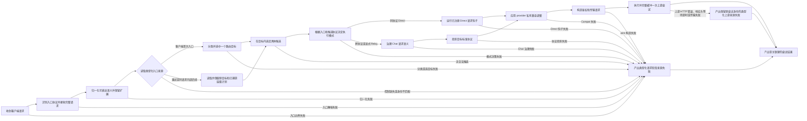
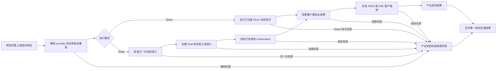
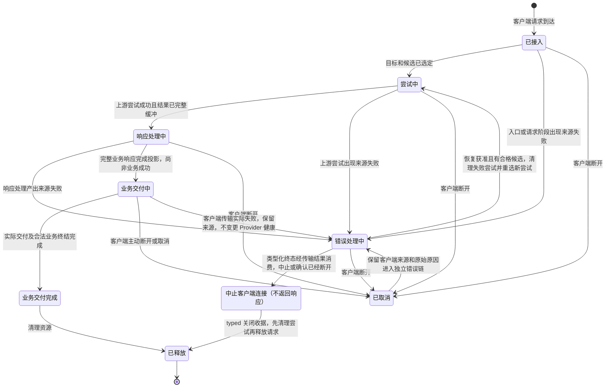

# V3 代理流水线：DAGPipe 目标图与首轮 gap 审计

状态：设计候选，尚未成为可编译或运行的 DAGPipe 图。审计基线：`origin/main` `39242705b41c6da0a87db7184cce4414e8628be0`；本轮只读现有 V3 map、入口和 Rust 源码，不修改已锁定骨架。

## 目标与边界

RouteCodex 的业务目标是透明代理：在不同客户端和上游协议之间最大限度保持请求、响应、历史、工具与流语义的连通性。代理新增的语义校验不得拦截本可兼容传递的请求或响应。信任边界、目标协议确实无法表达的字段和真实上游错误必须显式处理。控制资源、路由决策、provider 健康与业务 payload 分开。

本设计覆盖一个客户端请求触发的请求准备与上游尝试、成功响应、来源错误及取消后的资源终结。配置编译、启动探针、调试采样、部署和管理 API 是依赖或旁观者，不纳入业务 payload 图。图中的节点是业务责任，不是 Rust 函数调用；下表另列现有实现线索。

`provider_interface` 是 provider 配置到 target 候选接线的辅助对象流，登记在 `docs/architecture/dagpipe/graphs/provider-multi-interface-wiring.graph.json`。它不是第四个业务对象源，也不改变本文件“请求、响应、错误三源”的模型；它复用现有 V3Config02–V3Config05、V3Target08–V3Target10 owner，并由 `modules.json` 单独登记。

### 角色、对象与触发

| 角色 | 责任与权限 |
| --- | --- |
| 客户端 | 发起带协议、目标模型、历史和流意图的请求；可断开连接；接收真实业务结果，包括合法空响应；无可交付响应时中止客户端连接（不返回响应），不发送结束或通知消息。 |
| Server | 接入、边界限制、连接状态与最终 HTTP/SSE 发送；不改业务语义。 |
| Runtime | 持有单次请求及 provider 尝试生命周期、选择 Direct/Relay、缓冲尝试结果；不把错误伪装成成功。 |
| Router / Target | 分类、选中一个不透明目标、展开和重选该目标内候选；不改 payload。 |
| Chat Process / Direct hook | 分别在 Relay / Direct 模式拥有声明的 payload 改写；互不代写。 |
| Provider / Error | Provider 负责 wire、鉴权、传输和健康；Error 负责内部来源分类、恢复动作与耗尽决策，禁止客户端错误投影；所有模型入口遵守 AGENTS.md 的无错误响应硬约束。 |

一个图执行的关联键是请求 ID 与尝试 ID。客户端请求、上游成功响应、来源失败是三个独立对象源；分别建图，不能把三者伪装成一个多入口 DAG。以下是**业务目标图**，尚非 DAGPipe `CompiledGraph`。

## 请求图：客户端请求 → 一次上游尝试结果

入口 ARC 是客户端请求及独立的类型化控制引用；唯一出口 ARC 是本次处理结果，标记上游业务响应、上游来源失败或入口/请求阶段来源失败。每个节点失败在业务目标上汇入同一类型化出口，再由 Runtime 送入独立 Error 图。响应头等待超时保留原 provider/model/key、请求与尝试身份及响应等待/transport 来源，不能因候选重选位置改写为请求归一化失败或合成 request 598。内部 network 502、真实请求阶段 598、真实响应处理 599 保留各自来源；无上游 HTTP 状态时不捏造 upstream HTTP 502。DAGPipe 落地时须用类型化结果 ARC 或明确的 Runtime 转换承接失败，不能假设 Operator 抛错后下游失败节点仍会执行。模式选择是显式分支。Provider 失败后的重选由图外 Runtime 消费 typed Error 的 switch_provider/reselect 恢复决策，清理失败 attempt 并建立**新尝试**，不在静态 DAG 中画回边。未出现合法候选时产出类型化来源失败，不静默换模型。

## 响应图：一次上游成功响应 → 响应处理结果

入口 ARC 是上游成功响应，加同一请求的类型化模式/协议引用；唯一出口 ARC 是带成功客户端结果或类型化响应阶段来源失败的**响应处理结果**。失败由生命周期送入错误图，不在响应图内伪装成成功。Provider 尝试在提交客户端响应前完整缓冲。SSE 是客户端传输边界，按已确定的客户端语义成帧，不从 SSE 字节重建路由、错误或 continuation 控制状态。Direct 不进入 Relay Chat Process；Relay 的 continuation 保存只接受已完成响应。

## 错误图：一次来源失败 → 唯一内部错误决策

| 语义节点 | 实际注册绑定（身份与顺序不变） |
| --- | --- |
| 保留来源与原始原因 | ErrorErr01SourceRaised |
| 捕获宿主上下文 | ErrorErr02HostCaptured |
| 分类真实来源 | ErrorErr03RuntimeClassified |
| 按来源决定恢复与耗尽策略 | ErrorErr04RouterPolicyApplied |
| 生成类型化执行决策 | ErrorErr05ExecutionDecision |
| 交付唯一内部错误结果 | ErrorErr06ClientProjected；legacy 名称仅表示 internal-error-outcome |

Server/SSE 观测客户端传输失败或断开、RuntimeCancellation 观测取消，保留原始 cause 进入 source-failure，完整经过上述独立错误链。真正内部响应处理失败保留 internal_response 来源。三者均不 switch provider、不排除候选、不冷却 Provider；只有绑定真实 Provider 尝试的失败才能进入其恢复策略。新增来源转换均 design-pending，取消转换不声称已有 Rust 枚举。

入口 ARC 是类型化来源失败；provider/模型/鉴权身份仅在来源确属该 provider 尝试时存在。唯一出口 ARC 是内部类型化错误决策，不存在到客户端业务响应的边。`新尝试请求事件` 由生命周期 owner 消费并创建新的尝试 ID，不是指向请求图内部节点的回边。仅在当前策略允许时发起新尝试。Provider 状态、SSE 解码错误及 Server/请求/响应阶段错误均只供内部分类和管理，禁止 HTTP 错误状态、错误体或协议错误事件；池空/耗尽也只能无响应或未完成传输。请求局部兼容失败只排除本次候选，不冷却 provider。调试日志、snapshot 和样本只记录证据，不承载决策真相。

## 请求生命周期状态

状态机由 Runtime/Server 边界拥有，DAGPipe 静态图不承担循环调度。请求取消或客户端主动断开必须先进入独立 typed Error 链，经 RuntimeTransportOutcome 和 Server 中止／确认已断开的 typed 收据，再 drain、attempt cleanup、finalizer；不归为 Provider 失败。Server 可提前建立 SSE 并发送传输 keepalive；接入、投影和开始交付均不证明业务成功。完整业务响应包括合法空响应及合法 content_filter 终结，须忠实交付，不增加非空校验。无可用 Provider 或无可交付响应时，RuntimeTransportOutcome 将内部 typed 中止意图交给 Server：中止客户端连接（不返回响应）。这不是正常空 EOF、[DONE]、成功结束、错误 payload/status、终止事件或客户端通知。Server 记录 typed 关闭收据，先清理 attempt 再由 finalizer 释放 request；释放资源不证明业务成功。目标契约要求 provider 尝试提交前完整缓冲；若现有 SSE 路径仍观测到上游提交后失败，应作为 G6 的实现/契约差异核对，不能暗中把它当成新业务成功或重选机会。

## 首轮图审计

| 检查 | 目标图结论 | 需要的落地证据 |
| --- | --- | --- |
| 单源单汇 | 三个对象源分别有唯一入口 ARC 和唯一出口 ARC；Direct/Relay 在各自图内汇合。 | 每个 DAGPipe JSON 经 `dagpipe graph validate`，且无无主入口、悬空节点或多出口。 |
| 分支与重试 | Router/Target 选目标与候选，Runtime 独立决定模式；失败只输出新尝试事件，重试跨执行。 | 两种 owner 的绑定、尝试 ID 的状态机/ARC 绑定与成功、失败测试。 |
| 透明代理 | 保留可表达语义和扩展；Direct/Relay 改写权限分开；无多余语义拒绝。 | 协议字段正反例、上游 wire 与客户端结果的同入口对照。 |
| 终点 | 业务交付完成、中止客户端连接（不返回响应）、取消／主动断开各自清理资源；响应处理失败进入独立 Error 恢复，耗尽由 Server 中止连接，不返回正常空结束或任何终止消息；清理不证明业务成功。 | 真实入口和连接断开回放、错误链与 typed 关闭收据。 |
| 图与代码 | 三张业务目标图和 `provider_interface` 辅助图已登记；当前 Rust runtime 只编译并运行请求图的 `capture_client_json` Node01 切片。 | 后续节点逐一完成 Operator 注册、SDK compile、实际入口 journal/ARC 与相同语义结果；辅助图不冒充业务图运行证明。 |

## 现有实现线索与 gap

| ID | 目标节点/边 | 当前可见证据 | Gap / 下一步 |
| --- | --- | --- | --- |
| G1 | 业务语义图成为项目真源 | 请求、响应、错误三张 `v3.operation_runner.*.graph.json` 已登记；`v3-operation-runner-dagpipe` 验证图合同，`modules.json` 验证静态登记。 | 后续逐节点核对目标业务图、ARC/分支合同与现有图；静态图不能证明整条运行接线。 |
| G2 | 节点绑定为可执行 Operator | `operation_runner` 已从请求图派生并编译 `capture_client_json` Node01 切片，HTTP 与 Responses WebSocket 入口使用同一编译结果；其余节点尚未运行。 | 沿唯一 owner 逐一落实余下节点的 Operator 名称/版本、ARC schema、作用权限和 SDK compile；每步核对真实入口。 |
| G3 | 请求入口到模式分支 | `v3/crates/routecodex-v3-server/src/lib.rs` 声明 HTTP 入口；`endpoint_handlers.rs`、`executors.rs` 接到 Runtime；`v3-mainline-call-map.yml` 有 `v3.responses_direct.required_mainline`。 | 用真实请求 ID 核对 Direct/Relay 决策和候选引用；不能把 map 的 `anchored` 或测试锚点当成所有协议的运行证明。 |
| G4 | Relay 与 Direct 的响应分支 | `v3.hub_pipeline.v1.request/response` 与 `v3.hub_relay.*` map 分别列静态骨架及 Relay source slice；`hub_v1.rs` 导出相邻 builder 与 Direct/Relay 路径。 | 各选一个真实成功样本，对比 provider raw、Chat/Direct 作用点、continuation、客户端 JSON/SSE；再决定 Operator 边界。 |
| G5 | 错误、重选与终端 | `v3.debug_error_foundation.mainline` map 列 Error01–06；`v3.hub_relay.response_failure_entry` 声明响应治理失败接 Error01；Runtime `kernel.rs` 持有尝试计数和传输尝试。 | 分别用 Server/请求、provider、响应阶段失败样本核对状态；仅对已绑定 provider 身份且策略要求冷却的类型化失败更新健康，验证请求局部排除、目标内重选、598/599/502 及客户端与 provider 状态隔离。为新尝试 ID、响应失败接线及释放终点补类型化证据。 |
| G6 | 取消、提交后流中断与资源释放 | 当前 map 主要记录请求/响应/错误调用边，也有提交后 SSE 观测与 EOF/error/drop 的局部合同；本轮未绑定 DAGPipe 状态机与每终点资源收据。 | 明确连接断开、上游尝试取消、SSE 关闭的 owner、事件与验收；核对提交前完整缓冲与现有提交后观测的关系，补同入口取消/流中断回放。 |

**审计结论：三张静态图已登记，Node01 切片已接入；整条请求、响应、错误图仍未运行。** 后续沿 G2–G6 逐节点核对图、Operator、调用边和真实入口证据，不以静态校验或 Node01 证据推断全图完成。修改项目锁定骨架节点、边、owner 或资源流之前，先遵守 `docs/architecture/wiki/v3-mainline-skeleton-sop.md` 的授权边界。

### 重入资源绑定（新增接线 design-pending）

| 语义责任 | 绑定与生命周期 |
| --- | --- |
| 首次入口选目标 | RuntimeRequestGraphEntry 显式创建 client_entry；resolve_target（Virtual Router）条件写 v3.route.opaque_target |
| 重试／同请求内部后续保留目标 | origin=retry/internal_followup；resolve_target 读 typed origin 与原 opaque target，保留 requestId/targetId/capturedTierPlan；Target Interpreter 仅在原目标内重选 |
| 释放目标 | request 范围到 RuntimeRequestFinalizer；attempt cleanup 不释放；缺失控制进入 Error，不从 payload 重建、不默认入口、不跳固定节点 |
| 终态消费权限 | v3.error.execution_decision 新 reader RuntimeTransportOutcome 为 design-pending；保留 RuntimeClientCommit 等既有权限 |
