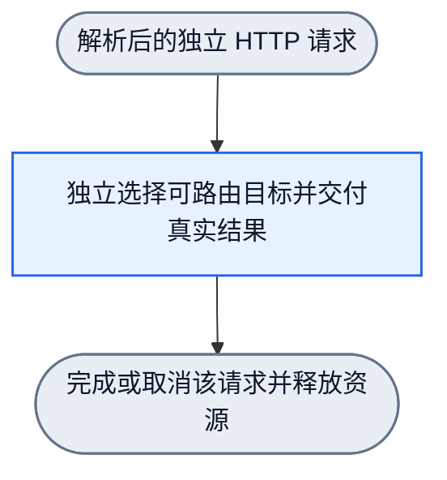

# HTTP 请求独立执行

每个 HTTP 请求独立进入 Runtime。同一 session 或 conversation 的请求不排队，不创建会话锁、token 或响应体持锁 permit。取消或完成一个请求不拥有另一个请求的执行权。

职责图源是 [http-request-isolation.graph.json](../dagpipe/graphs/http-request-isolation.graph.json)。它是静态设计图，不表示已注册可执行 Rust Operator。请求具有单一入口和单一资源释放出口；成功、失败和取消都在该请求内结算。

Server 的 `pending_model_request` 直接调用现有 Runtime 入口。会话 header 保留原有协议用途，不用于控制 HTTP 请求的并发。不同监听端口采用相同语义。

Runtime 按真实健康状态选择目标。其他请求持有的本地并发容量不构成业务准入条件，不排除尚未尝试的可路由目标。Provider transport 不因进程内计数而拒绝业务请求；不同端口和模型不能通过共享容量互相阻断。真实上游失败仍进入原有 Error 链与恢复策略。

`request_activity` 只记录独立请求的活动与重启维护。它不读取 session 或 conversation。Front EOF 与有序 flush 的资源释放行为不变；本次消融不修改重启协议或 provider 恢复策略。

公共入口回归覆盖：A 保持未完成时，与 A 相同 session、相同 conversation 或两者均相同的 B 能进入 provider 并完成；不同端口并发；取消 A 后其他请求仍可完成；跨端口请求数超过原本地容量时全部进入上游并交付真实响应。必要的维护测试单独验证重启协调。
