# V3 Provider Action Gate

Canonical implementation plan:
`docs/goals/direct-relay-cross-request-error-storm-control-plan.md`.

Each request retains its own cancellation, attempts, exclusions and original
deadline. A real session is never a business action lock. Distinct complete
provider/interface/model/key identities cannot change each other's action
delay, generation, observation lease or terminal disposition. Waiter count is
not a new failure. Only the declared health observation owners coordinate
recovery within their listener, and the gate itself is Provider-lifecycle
state: it records observation outcomes and never admits, waits on, or blocks a
request. Normal provider capacity limits remain effective.

```mermaid
flowchart TD
  Compat[ProviderReqCompat06ProviderCompat]
  Wire[V3ProviderReqOutbound08WirePayload]
  E01[V3Error01SourceRaised]
  E05[V3Error05ExecutionDecision]
  E06[V3Error06ClientProjected]
  Gate[V3ProviderObservationState]
  Permit[V3ProviderActionPermitInFlight]
  Abandoned[V3ProviderActionPermitAbandoned]
  SuccessObserved[V3ProviderActionSuccessObserved]
  FailureObserved[V3ProviderActionFailureObserved]
  SuccessFinalize[V3ProviderActionSuccessFinalize]
  SuccessRecorded[V3ProviderActionSuccessRecorded]
  FailureRecorded[V3ProviderActionFailureRecorded]
  ProviderRaw[V3ProviderRespInbound01Raw]
  ProviderCodec[V3ProviderResponsesEventCodec]
  ProviderOutcome[V3ProviderResponsesTerminalOrFailureObserved]
  Success[V3 Provider Success]
  Terminal[V3 Terminal Exhaustion]
  Reevaluate[V3SelectionAndError05Reevaluation]

  Compat -->|v3-provider-action-gate-01| E05
  Wire -->|v3-provider-action-gate-02| E05
  E05 -->|v3-provider-action-gate-05| E06
  E01 -->|v3-provider-action-gate-14| E05
  E01 -->|v3-provider-action-gate-15| E05
  E01 -->|v3-provider-action-gate-16| E05
  Permit -->|v3-provider-action-gate-33| SuccessObserved
  SuccessObserved -->|v3-provider-action-gate-34| SuccessRecorded
  Abandoned -->|v3-provider-action-gate-35| FailureObserved
  FailureObserved -->|v3-provider-action-gate-36| FailureRecorded
  Permit -->|v3-provider-action-gate-37| SuccessObserved
  SuccessObserved -->|v3-provider-action-gate-38| SuccessRecorded
  Permit -->|v3-provider-action-gate-39| FailureObserved
  Abandoned -->|v3-provider-action-gate-40| FailureRecorded
  Permit -->|v3-provider-action-gate-41| SuccessObserved
  SuccessObserved -->|v3-provider-action-gate-42| SuccessRecorded
  Permit -->|v3-provider-action-gate-43| FailureObserved
  Abandoned -->|v3-provider-action-gate-44| FailureRecorded
  Permit -->|v3-provider-action-gate-45| SuccessRecorded
  Permit -->|v3-provider-action-gate-46| SuccessFinalize
  SuccessFinalize -->|v3-provider-action-gate-47| SuccessRecorded
  ProviderRaw -->|v3-provider-action-gate-48| ProviderCodec
  ProviderCodec -->|v3-provider-action-gate-49| ProviderOutcome
  ProviderRaw -->|v3-provider-action-gate-50| ProviderCodec
  ProviderCodec -->|v3-provider-action-gate-51| ProviderOutcome
  Success -->|reset scoped failure state| Gate
  Terminal -->|advance sustained generation| Gate
  Gate -->|typed terminal wake, no provider send| Reevaluate
```

The gate is a process-local control side channel keyed by server, routing group,
session, provider runtime identity, and normalized error family. It does not
enter request, response, metadata, continuation, snapshot, or persistent
provider-health truth. Provider HTTP 429 is an ordinary typed provider failure
on this surface: it holds no special lane, minimum, or probe requirement here,
and multi-candidate requests switch to the next visible complete identity
immediately while the last candidate's original typed Error passes through to
the client per the v27 last-candidate passthrough contract.

Review locks:

- A request never waits for, acquires, or holds this gate. Request execution
  selects from currently visible pools and proceeds immediately; real client
  cancellation, the original request deadline, and real transport failures
  keep their own semantics.
- First isolated provider failure waits at least 1 second before the next
  observation action for that identity.
- A second failure before success or an overlapping observer promotes the
  scope to sustained mode and waits at least 5 seconds.
- Switching provider runtime identity or normalized error family inside the
  same active server/routing-group lane remains sustained and cannot restart
  the one-second floor.
- One generation admits exactly one observation action; the observation lease
  is held only by the Provider lifecycle (precool probes), never by a
  business request.
- Provider success, provider failure, terminal commit, or lease drop/explicit
  abandon releases observation ownership. Abandon is health-neutral and starts
  a new sustained five-second floor without incrementing consecutive failures.
- Provider success resets the matching state.
- A same-group success from an unrelated provider runtime identity cannot
  reset an owned observation lease or its matching failure state.
- Missing gate state or notification-channel closure fails explicitly; neither
  can be wrapped as provider success.
- Streaming success is recorded only after protocol terminal evidence and clean EOF.
  For provider Responses SSE, only `response.completed` is semantic terminal truth;
  Responses 协议没有 `response.done` 事件，`[DONE]` 是 Chat Completions 的终止符，
  不得出现在 Responses 客户端边界。
  Malformed events, premature EOF, provider stream errors, `response.failed`, and
  post-terminal parse failures record provider failure and leave the next action gated.
- Terminal exhaustion is not success: old observers re-evaluate selection/Error05, and
  the next provider action remains serialized behind a new five-second generation.
  Terminal handling never authorizes a model-client error response; AGENTS.md's
  mandatory all-entry no-client-error contract applies even on exhaustion, with the
  v27 last-candidate passthrough as the sole typed exception. A concurrent
  routing-group success cannot turn a stale failure into client output.
- Client disconnect is health-neutral and does not enter this gate.
- SSE transport/decode/malformed-event/EOF/hang is also provider-health-neutral. Before
  business-byte commit it uses the existing retry/reselect path; after commit it only
  closes the request-scoped action lane and fails the stream explicitly. It never writes
  provider consecutive failures, cooldown, probes, or cross-session blacklist state.
- FIFO waiter tickets preserve deterministic order; cancelling one waiter removes only
  that ticket.
- Only a typed terminal Error05 exhaustion decision may construct Error06.
- Terminal Error06 projection records and commits its failure generation without
  waiting for provider action admission. The commit advances the lane group so later
  provider actions retain the storm-control delay.
- Runtime does not pass that commit result as a typed witness into
  `terminal_projection_for`. The machine map therefore stops at
  `V3ProviderActionGateTerminalCommitted` and does not fabricate a
  `TerminalCommitted -> V3Error05TerminalDecision/Error06` edge. Typed Error05-to-Error06
  projection remains owned by `routecodex-v3-error`.
- Responses Relay `ProviderReqCompat06ProviderCompat` and
  `V3ProviderReqOutbound08WirePayload` failures enter
  `handle_v3_responses_relay_provider_failure`, then
  `run_v3_relay_provider_failure_policy`; they cannot return directly as provider-bound
  request errors or bypass typed Error05 handling.
- The machine gate requires the exact frozen edge set, resolves every declared symbol in
  its declared source, verifies each caller body invokes its callee, and compares every
  map edge endpoint/status/symbol/source field with this lifecycle manifest.
- Traffic Governor saturation is a separate typed admission-backpressure lane. Its
  blocking acquire runs off the Node event loop and never enters provider health,
  Error05 retry/reselect, or provider 429 projection.
