# V3 Provider Action Gate

Canonical implementation plan:
`docs/goals/direct-relay-cross-request-error-storm-control-plan.md`.

This resource is background observation only. Request selection, transport,
retry, reselection, cancellation, and deadline handling never read or wait on a
provider-action permit, queue, recovery ticket, or admission lane. Provider
HTTP 429 remains exact provider-runtime-identity health evidence. A request
continues through its declared successors without waiting for background
cooldown, probe, or recovery work.

```mermaid
flowchart TD
  Compat[ProviderReqCompat06ProviderCompat]
  Wire[V3ProviderReqOutbound08WirePayload]
  E01[V3Error01SourceRaised]
  E05[V3Error05ExecutionDecision]
  E06[V3Error06ClientProjected]
  TerminalCommit[V3ProviderActionGateTerminalCommitted]
  SuccessObserved[V3ProviderActionSuccessObserved]
  FailureObserved[V3ProviderActionFailureObserved]
  SuccessFinalize[V3ProviderActionSuccessFinalize]
  SuccessRecorded[V3ProviderActionSuccessRecorded]
  FailureRecorded[V3ProviderActionFailureRecorded]
  ProviderRaw[V3ProviderRespInbound01Raw]
  ProviderCodec[V3ProviderResponsesEventCodec]
  ProviderOutcome[V3ProviderResponsesTerminalOrFailureObserved]

  Compat -->|v3-provider-action-gate-01| E05
  Wire -->|v3-provider-action-gate-02| E05
  E05 -->|v3-provider-action-gate-05| E06
  E05 -->|v3-provider-action-gate-06| TerminalCommit
  E01 -->|v3-provider-action-gate-14| E05
  E01 -->|v3-provider-action-gate-15| E05
  E01 -->|v3-provider-action-gate-16| E05
  ProviderRaw -->|v3-provider-action-gate-33| SuccessObserved
  SuccessObserved -->|v3-provider-action-gate-34| SuccessRecorded
  FailureObserved -->|v3-provider-action-gate-36| FailureRecorded
  ProviderRaw -->|v3-provider-action-gate-37| SuccessObserved
  SuccessObserved -->|v3-provider-action-gate-38| SuccessRecorded
  ProviderRaw -->|v3-provider-action-gate-46| SuccessFinalize
  SuccessFinalize -->|v3-provider-action-gate-47| SuccessRecorded
  ProviderRaw -->|v3-provider-action-gate-48| ProviderCodec
  ProviderCodec -->|v3-provider-action-gate-49| ProviderOutcome
  ProviderRaw -->|v3-provider-action-gate-50| ProviderCodec
  ProviderCodec -->|v3-provider-action-gate-51| ProviderOutcome
```

Review locks:

- No request path calls `wait_for_error05_recovery`, acquires a provider action
  permit, joins a FIFO queue, or enters a deferred admission state.
- Provider selection scans the declared tier order, same-tier keys, and
  declared default successor immediately. Empty or cooled candidates continue
  to the next declared successor without a capacity, probe, or recovery wait.
- Each request retains its own cancellation, attempts, exclusions, and original
  deadline. A session is never a business action lock.
- Provider HTTP 429 observations remain exact provider-runtime-identity scoped
  within the owning listener. They are health and cooldown evidence, not a
  request admission lane.
- Background probes remain independently bounded. Probe scheduling, backlog,
  and in-flight state never gate request selection or transport.
- Provider success and failure observations update only their exact background
  health scope. An unrelated provider success cannot clear another identity's
  health state.
- Terminal Error05 projection commits its internal generation immediately. It
  never waits for background observation or request admission.
- Only a typed terminal Error05 decision may construct Error06. Provider HTTP
  errors and proxy-generated failures never become client success or error
  payloads.
- Streaming success is recorded only after protocol terminal evidence and a
  clean EOF. For provider Responses SSE, only `response.completed` is semantic
  terminal truth. Malformed events, premature EOF, provider stream errors,
  `response.failed`, and post-terminal parse failures record background failure.
- The machine gate requires the exact frozen edge set, resolves each declared
  symbol in its declared source, verifies each caller invokes its callee, and
  compares every edge endpoint, status, symbol, and source field with this
  lifecycle manifest.
