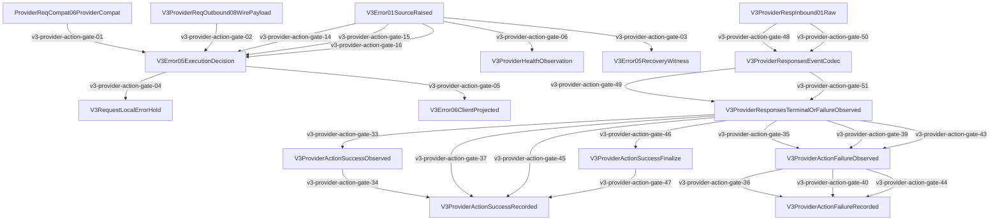

# V3 Provider Action Gate

Canonical implementation plan:
`docs/goals/direct-relay-cross-request-error-storm-control-plan.md`.

Status: `source_active_live_verification_required`.

Each request keeps its own cancellation, attempts, exclusions and original
deadline. A session is not a business action lock. Distinct complete
provider/interface/model/key identities cannot change each other's return hold,
health observation or terminal disposition. Fresh requests do not consume
another request's recovery state. Business request concurrency is not limited
by this path.

The action lifecycle is not a shared admission gate. A real provider error is
recorded immediately by the exact listener/provider/interface/model/key health
owner. Only a lawful final error transport close has an independent two-second
hold. Reselection, retry and recoverable pool exhaustion do not wait for it.
The hold belongs to that request and does not block a fresh request or another
complete identity.

Provider selection scans the route's declared tiers, later declared pools and
default. If a target is available, the request dispatches to it. Only a complete
declared-chain scan with no available target enters request recovery wait.
An expired residence deadline does not end a request while recovery remains
possible. A final close requires a current recovery and eligibility check.

Review locks:

- A real provider error records the exact provider/interface/model/auth-key
  health identity immediately, before the return hold.
- A lawful final error transport close holds independently for two seconds.
  Reselection, retry and recoverable exhaustion bypass that hold. The hold is
  request-local and never acquires a shared session, routing-group or provider
  action permit.
- Fresh requests do not consume another request's recovery witness or hold.
  Retired `provider_action_gate.rs` wait/permit/admission processes must not be
  restored.
- Provider selection tries every declared tier, subsequent pool and default
  before entering no-target recovery wait.
- Provider HTTP errors remain typed evidence and never become model-client error
  payloads. Exhaustion ends only the request transport and never fabricates a
  normal empty success.
- A correct provider business response, including model-generated invalid
  arguments, remains business content and is forwarded for client-side
  correction. Projection compatibility does not become semantic rejection.
- Successful provider observations record matching health only through the
  exact `_for_interface` health method.
- Malformed events, premature EOF, provider stream errors, `response.failed`,
  and post-terminal parse failures record provider failure and do not become
  success.
- For provider Responses SSE, only `response.completed` is semantic terminal
  truth. `response.done` is not a Responses event; `[DONE]` is a Chat Completions
  terminator and must not appear at the Responses client boundary.
- Only a typed terminal Error05 exhaustion decision may construct Error06.
  `terminal_projection_for` consumes that typed decision and does not receive a
  provider action gate witness.
- Client disconnect is health-neutral. It does not enter request recovery wait,
  record provider failure, or mutate provider health.
- Responses Relay `ProviderReqCompat06ProviderCompat` and
  `V3ProviderReqOutbound08WirePayload` failures enter
  `handle_v3_responses_relay_provider_failure`, then the shared provider failure
  policy. They cannot return directly as provider-bound request errors or bypass
  typed Error05 handling.
- The machine gate requires the exact frozen edge set, resolves every declared
  symbol in its declared source, verifies each caller body invokes its callee,
  and compares every map edge endpoint/status/symbol/source field with this
  lifecycle manifest.
- Traffic Governor saturation is a separate typed admission-backpressure lane.
  Its blocking acquire runs off the Node event loop and never enters provider
  health, Error05 retry/reselect, or provider 429 projection.
