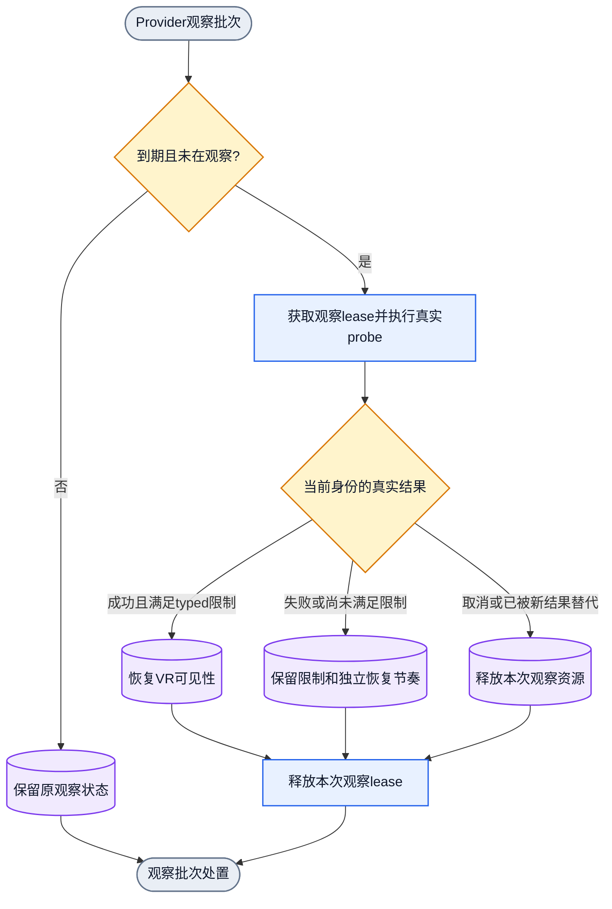

# Provider 独立观察生命周期

状态：候选源码。本文不证明生产升级或完整请求恢复已验收。`v3.provider_action_gate` 的既有feature/resource标识继续定位同一owner；请求waiter、FIFO、业务admission、Error05恢复witness和terminal commit已退役。

Provider探测、冷却、恢复只改变VR候选可见性。请求不持观察lease，不等待probe，不参与Provider观察的generation和节奏。请求当次消费已捕获的选择后直接transport；真实执行错误交统一typed Error和原路由owner重选。refill由Chat Process独立决定，连续最多额外一次。

## 单次观察的对象流

下图只描述已到期的一个Provider观察批次。未到期或已在观察的身份保留在独立生命周期中，等待下次调度；静态图不画回边。入口是该批次调度，出口是观察处置，符合SESE。它不是新的DAGPipe Operator注册声明。

## 唯一owner与调用

| 责任 | Owner |
|---|---|
| 登记真实失败并建立precool观察 | `V3ProviderFailureRuntimeHealth::defer_provider_health_action` |
| 按原观察节奏选择独立probe | `V3ProviderFailureRuntimeHealth::managed_precool_probe` |
| 同一观察身份的并发lease | `V3ProviderActionGate::try_admit_observation`、`V3ProviderObservationLease` |
| 消费真实probe结果并更新health | `V3ProviderFailureRuntimeHealth::complete_precool_observation`及既有Provider health store |
| 释放观察lease并保留恢复节奏 | `V3ProviderObservationLease::drop`、`V3ProviderActionGate::release_observation` |
| VR中候选可见性 | 既有Provider health投影与Target选择owner |

429 episode、最短冷却和必需probe限制由既有Provider health store承担。已退役的request action lane不另存一份429真相。已提交SSE的错误恢复和已交付帧保真仍按项目Mandatory Review审计，不能因观察生命周期已解耦而豁免。

## 验收边界

Provider观察测试验证due、lease、恢复节奏及完整身份隔离。公开HTTP锚点 `invisible_pool_uses_default_while_probe_is_held_` 验证Direct/Relay在probe未完成时仍走default，并保持健康兄弟请求独立。`issue44cc3af_untried_tier_attempt_` 验证失败后实际使用未尝试候选及refill的当前可见性选择。原始证据与尚未闭合项见Iris的 `request-gates-removal-20261105/result.md`。

call-map、manifest和专用gate已改为独立Provider观察绑定；静态gate的运行与正反fixtures仍须实际通过。当前依赖缺口和失败必须保留，不能将本文或局部行为回归冒称架构gate PASS。Mermaid已核对方向、分支和统一出口，视觉渲染未验收。
