# V3 Provider Action Gate

Historical implementation plan (superseded by AGENTS.md, requirements ledger v10
and the current contracts below):
`docs/goals/direct-relay-cross-request-error-storm-control-plan.md`.

Listener ports own independent provider health stores, persisted cooldown files,
probe registrations and action-gate lanes. Gate identity is the configured
listener server ID (bound to one port) plus the complete provider identity;
sessions on the same listener share its lane. A failure or success on another
listener cannot mutate, delay or release it. Automatic failure handling must
retain the last routable candidate of the current listener's request pool.

```mermaid
flowchart TD
  Compat[ProviderReqCompat06ProviderCompat]
  Wire[V3ProviderReqOutbound08WirePayload]
  E01[V3Error01SourceRaised]
  E05[V3Error05ExecutionDecision]
  Witness[V3Error05RecoveryWitness]
  Gate[V3ProviderActionGateAdmission]
  Retry[V3ExecutionRetryOrReselect]
  TerminalAdmission[V3ProviderActionGateTerminalAdmission]
  TerminalCommit[V3ProviderActionGateTerminalCommitted]
  Permit[V3ProviderActionPermitInFlight]
  AbandonRequest[V3ProviderActionPermitAbandonRequested]
  Abandoned[V3ProviderActionPermitAbandoned]
  SuccessObserved[V3ProviderActionSuccessObserved]
  FailureObserved[V3ProviderActionFailureObserved]
  SuccessFinalize[V3ProviderActionSuccessFinalize]
  SuccessRecorded[V3ProviderActionSuccessRecorded]
  FailureRecorded[V3ProviderActionFailureRecorded]
  ProviderRaw[V3ProviderRespInbound01Raw]
  ProviderCodec[V3ProviderResponsesEventCodec]
  ProviderOutcome[V3ProviderResponsesTerminalOrFailureObserved]
  Success[V3 Provider Success]
  Terminal[V3 Terminal Exhaustion]
  Reevaluate[V3SelectionAndError05Reevaluation]

  Compat -->|v3-provider-action-gate-01| E05
  Wire -->|v3-provider-action-gate-02| E05
  E05 -->|v3-provider-action-gate-03| Witness
  Witness -->|v3-provider-action-gate-04| Gate
  E05 -->|v3-provider-action-gate-05| TerminalAdmission
  TerminalAdmission -->|v3-provider-action-gate-06| TerminalCommit
  Gate -->|v3-provider-action-gate-07| Retry
  Witness -->|v3-provider-action-gate-08| Gate
  Witness -->|v3-provider-action-gate-10| Gate
  Witness -->|v3-provider-action-gate-11| Gate
  Witness -->|v3-provider-action-gate-12| Gate
  Witness -->|v3-provider-action-gate-13| Gate
  E01 -->|v3-provider-action-gate-14| E05
  E01 -->|v3-provider-action-gate-15| E05
  E01 -->|v3-provider-action-gate-16| E05
  Gate -->|v3-provider-action-gate-19| Permit
  Gate -->|v3-provider-action-gate-20| Permit
  Gate -->|v3-provider-action-gate-21| Permit
  Gate -->|v3-provider-action-gate-22| Permit
  Gate -->|v3-provider-action-gate-23| Permit
  Permit -->|v3-provider-action-gate-24| AbandonRequest
  Permit -->|v3-provider-action-gate-25| AbandonRequest
  Permit -->|v3-provider-action-gate-26| AbandonRequest
  Permit -->|v3-provider-action-gate-27| AbandonRequest
  Permit -->|v3-provider-action-gate-28| AbandonRequest
  Permit -->|v3-provider-action-gate-29| AbandonRequest
  Permit -->|v3-provider-action-gate-30| AbandonRequest
  Permit -->|v3-provider-action-gate-31| AbandonRequest
  AbandonRequest -->|v3-provider-action-gate-32| Abandoned
  Permit -->|v3-provider-action-gate-33| SuccessObserved
  SuccessObserved -->|v3-provider-action-gate-34| SuccessRecorded
  Abandoned -->|v3-provider-action-gate-35| FailureObserved
  FailureObserved -->|v3-provider-action-gate-36| FailureRecorded
  Permit -->|v3-provider-action-gate-37| SuccessObserved
  SuccessObserved -->|v3-provider-action-gate-38| SuccessRecorded
  Permit -->|v3-provider-action-gate-39| FailureObserved
  Abandoned -->|v3-provider-action-gate-40| FailureRecorded
  Permit -->|v3-provider-action-gate-41| SuccessObserved
  SuccessObserved -->|v3-provider-action-gate-42| SuccessRecorded
  Permit -->|v3-provider-action-gate-43| FailureObserved
  Abandoned -->|v3-provider-action-gate-44| FailureRecorded
  Permit -->|v3-provider-action-gate-45| SuccessRecorded
  Permit -->|v3-provider-action-gate-46| SuccessFinalize
  SuccessFinalize -->|v3-provider-action-gate-47| SuccessRecorded
  ProviderRaw -->|v3-provider-action-gate-48| ProviderCodec
  ProviderCodec -->|v3-provider-action-gate-49| ProviderOutcome
  ProviderRaw -->|v3-provider-action-gate-50| ProviderCodec
  ProviderCodec -->|v3-provider-action-gate-51| ProviderOutcome
  Success -->|reset scoped failure state| Gate
  Terminal -->|advance sustained generation| Gate
  Gate -->|typed terminal wake, no provider send| Reevaluate
```

The gate is a process-local control side channel keyed only by the complete
provider runtime identity (interface, provider, model, key). Sessions, servers,
routing groups and error families retain diagnostic provenance but share that
identity's waiting state. It does not enter request,
response, metadata, continuation, snapshot, or persistent provider-health truth.

Review locks:

- First isolated provider failure waits at least 1 second.
- Consecutive failures of one identity use the cyclic 1, 3, 5, 16, 30 second delay.
- Switching to a different identity checks only that identity's gate. A healthy
  alternative sends immediately. Changing session or error family cannot bypass
  the failed identity's existing gate.
- Direct and Relay use the same serialized health transition to count currently
  routable request-eligible alternatives. The last identity stays routable and
  is not added to request exclusion. Other cooled identities retain their state.
- An incomplete provider attempt, including EOF without `message_stop`, is dropped
  internally and retried. No partial attempt payload reaches the client. A retry
  resends the full provider-bound request within the declared attempt and residence
  budgets. Exhaustion preserves the original typed cause and ends only that transport.
- One generation admits exactly one retry or reselect action.
- Fresh normal requests read the selected identity's existing recovery witness.
  They share its wait across requests and sessions without consuming unrelated lanes.
  Both fresh and retry waits are bounded by the current request's residence deadline.
- Admission returns a Rust-owned `V3ProviderActionPermit`. Elapsed wall-clock time never
  releases an owned provider action, including a legal lazy SSE longer than five
  seconds.
- Provider success, provider failure, terminal commit, or permit drop/explicit abandon
  releases ownership. Queueing, terminal bookkeeping and abandonment do not add
  another delay or advance the failure cycle.
- A caller that observes provider failure releases its admitted permit before awaiting
  Error05 retry/reselect/terminal policy. Holding that permit across terminal admission
  is a self-deadlock because terminal admission cannot become the permit's own release
  signal.
- Provider success resets the matching state.
- Real provider success clears that identity's delay and failure streak immediately.
  Queued recovery witnesses re-evaluate against its success generation. The state
  is memory-only; a full process restart clears it.
- A same-group success from an unrelated provider runtime identity cannot reset an owned
  permit or its matching failure state.
- Missing gate state or notification-channel closure fails explicitly; neither can be
  wrapped as provider success.
- Streaming success is recorded only after protocol terminal evidence and clean EOF.
  For provider Responses SSE, only `response.completed` is semantic terminal truth;
  Responses 协议没有 `response.done` 事件，`[DONE]` 是 Chat Completions 的终止符，
  不得出现在 Responses 客户端边界。
  Malformed events, premature EOF, provider stream errors, `response.failed`, and
  post-terminal parse failures record provider failure and leave the next action gated.
- Terminal exhaustion is not success: old waiters re-evaluate selection/Error05,
  preserving the failed identity's existing backoff without adding another delay.
  Terminal handling never authorizes a model-client error response; AGENTS.md's
  mandatory all-entry no-client-error contract applies even on exhaustion. A concurrent
  routing-group success cannot turn a stale failure into client output.
- A fresh request bypasses an unrelated recovery lane.
- Client disconnect is health-neutral and does not enter this gate.
- SSE transport/decode/malformed-event/EOF/hang enters the typed provider failure
  policy before any buffered business payload is committed. Health changes apply
  only to the failed identity and must preserve the last routable identity.
- FIFO waiter tickets preserve deterministic order; cancelling one waiter removes only
  that ticket.
- Only a typed terminal Error05 exhaustion decision may construct Error06.
- Terminal Error06 projection records and commits its failure generation without
  waiting for provider action admission. The commit advances the lane group so later
  provider actions retain the storm-control delay.
- Runtime does not pass that commit result as a typed witness into
  `terminal_projection_for`. The machine map therefore stops at
  `V3ProviderActionGateTerminalCommitted` and does not fabricate a
  `TerminalCommitted -> V3Error05TerminalDecision/Error06` edge. Typed Error05-to-Error06
  projection remains owned by `routecodex-v3-error`.
- Responses Relay `ProviderReqCompat06ProviderCompat` and
  `V3ProviderReqOutbound08WirePayload` failures enter
  `handle_v3_responses_relay_provider_failure`, then
  `run_v3_relay_provider_failure_policy`; they cannot return directly as provider-bound
  request errors or bypass typed Error05 admission.
- The machine gate requires the exact frozen edge set, resolves every declared symbol in
  its declared source, verifies each caller body invokes its callee, and compares every
  map edge endpoint/status/symbol/source field with this lifecycle manifest.
- Traffic Governor saturation is a separate typed admission-backpressure lane. Its
  blocking acquire runs off the Node event loop and never enters provider health,
  Error05 retry/reselect, or provider 429 projection.
