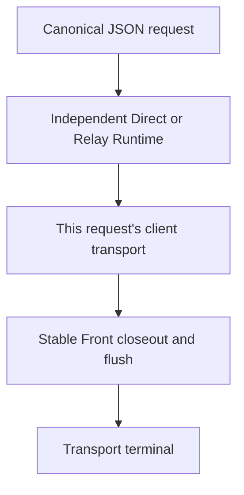

# V3 Independent Responses Dispatch

## Owner

- Feature: `v3.responses_session_inflight_admission` (retained registry ID).
- Input resource: `v3.server.validated_http_input`.
- Front closeout and flush resource: `v3.front.client_closeout_frame`.
- Crate: `routecodex-v3-server`.
- Entry: `pending_model_request` → `pending_endpoint_after_json_parse`.

## Lifecycle

This is one request's single-entry/single-exit lifecycle. There is no request
activity gate, body permit, or maintenance waiter between canonical parsing and
dispatch. Session or conversation facts never create a business mutex.

## Contract

1. Matching session, conversation or both never creates a business mutex.
2. Each request owns its cancellation, original deadline, attempts and response.
3. `read_json_payload` remains the sole HTTP JSON parser. Real identities and
   history remain intact; do not change them to evade admission.
4. Exact provider capacity and health remain with their existing typed owners.
   Healthy alternatives remain usable while another identity is constrained.
5. Parsed HTTP dispatch remains independent. Restart handoff does not wait for
   all business activity to become zero.
6. Existing `V3StableFrontSocket` owns queued-byte closeout: after a close
   signal wins the biased select, it drains commands already in `write_rx`
   under `V3_FRONT_CLOSE_FLUSH`, then shuts down the socket. This is transport
   cleanup, not a Provider drain gate.

## Public Acceptance

- Hold the first upstream response. Require a second upstream receipt before
  releasing the first, including session-only and conversation-only matches.
- Cover native Direct and real Chat Relay, preserving actual business results.
- Require the second request to arrive before cancelling the first. Cancellation
  must not cancel the second request or remove its delivery rights.
- Keep the existing Front queued-head, zero-byte and EOF closeout tests bound to
  the real Front owner.

Source tests do not establish formal runtime deployment or historical live causes.
