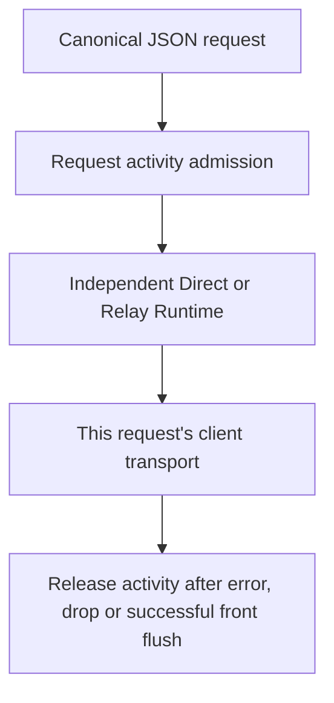

# V3 Independent Responses Dispatch

## Owner

- Feature: `v3.responses_session_inflight_admission` (retained registry ID).
- Resource: existing `v3.front.request_activity_gate`.
- Crate: `routecodex-v3-server`.
- Entry: `pending_model_request` → `pending_endpoint_after_json_parse`.

## Lifecycle

This is one request's single-entry/single-exit lifecycle. Explicit aggregate
maintenance pauses new dispatch at the existing activity owner. It does not
serialize ordinary requests by business identity.

## Contract

1. Matching session, conversation or both never creates a business mutex.
2. Each request owns its cancellation, original deadline, attempts and response.
3. `read_json_payload` remains the sole HTTP JSON parser. Real identities and
   history remain intact; do not change them to evade admission.
4. Exact provider capacity and health remain with their existing typed owners.
   Healthy alternatives remain usable while another identity is constrained.
5. Explicit maintenance pauses new dispatch atomically. Cancelling its owner
   restores dispatch. Restart preparation does not drain accepted business work.
6. Request activity stays with the response body; successful EOF transfers it
   to the stable front socket until flush. Error/drop releases only that request.

## Public Acceptance

- Hold the first upstream response. Require a second upstream receipt before
  releasing the first, including session-only and conversation-only matches.
- Cover native Direct and real Chat Relay, preserving actual business results.
- Require the second request to arrive before cancelling the first. Cancellation
  must not cancel the second request or remove its delivery rights.
- Explicit maintenance must still pause new requests and resume after cancellation.
- Keep configured capacity, separate identities and front-flush custody covered.

Source tests do not establish formal runtime deployment or historical live causes.
