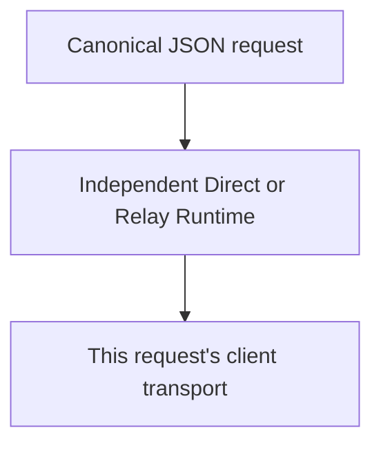

# V3 Independent Responses Dispatch

## Owner

- Feature: `v3.responses_session_inflight_admission` (retained registry ID).
- Crate: `routecodex-v3-server`.
- Entry: `pending_model_request` → `pending_endpoint_after_json_parse`.

## Lifecycle

This is one request's single-entry/single-exit lifecycle. Restart preparation
does not pause business dispatch or serialize requests by business identity.

## Contract

1. Matching session, conversation or both never creates a business mutex.
2. Each request owns its cancellation, original deadline, attempts and response.
3. `read_json_payload` remains the sole HTTP JSON parser. Real identities and
   history remain intact; do not change them to evade admission.
4. Exact provider health remains with its existing typed owner.
   Healthy alternatives remain usable while another identity is constrained.
5. Restart preparation does not pause dispatch or drain accepted business work.
   Cancelling preparation preserves valid existing client connections.

## Public Acceptance

- Hold the first upstream response. Require a second upstream receipt before
  releasing the first, including session-only and conversation-only matches.
- Cover native Direct and real Chat Relay, preserving actual business results.
- Require the second request to arrive before cancelling the first. Cancellation
  must not cancel the second request or remove its delivery rights.
- A second request reaches its provider while restart preparation is active.
- Preserve separate request identities and client transport completion.

Source tests do not establish formal runtime deployment or historical live causes.
