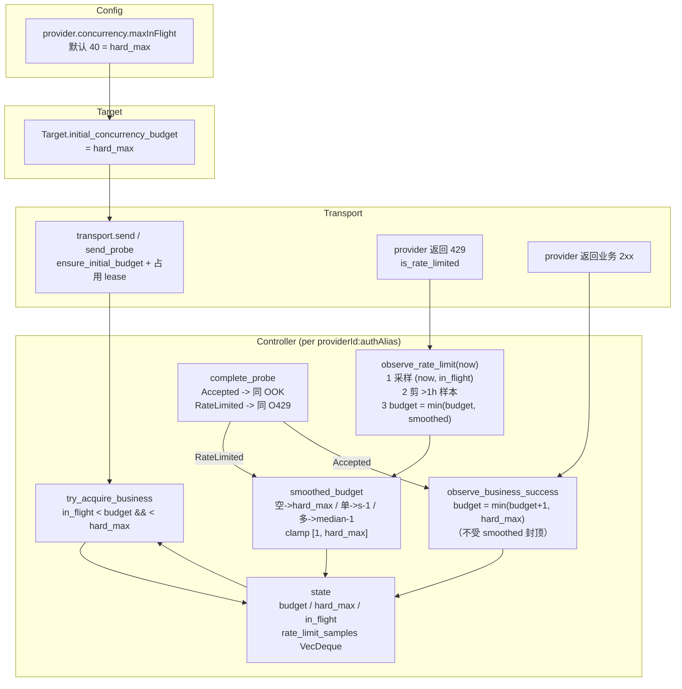

# 自适应并发预算（429 样本驱动）设计

## 目标

把 `provider.concurrency.maxInFlight` 从"静态预算"改为"静态硬上限（默认 40）"，
动态预算由过去一小时 429 观测样本平滑得出。

用户需求原文：
1. 429 时看当时 inflight 有多少并发，作为基准进行调节
2. 用过去一个小时的 429 的 inflight 做平滑
3. 静态 maxInFlight 只做上限，默认给 40

## 现状（改前）

```
Config: provider.concurrency.maxInFlight (默认 8)
   └─> Target.initial_concurrency_budget
         └─> transport.rs: ensure_initial_budget(key, budget)   // budget 与 hard_max 同值
               ├─> try_acquire_business(key)  : in_flight < budget && in_flight < hard_max
               ├─> observe_rate_limit(key)    : budget -= 1        ← 不看当时 inflight
               ├─> observe_business_success(key): budget += 1     ← 无时间窗口
               └─> complete_probe(key, result) : ±1，10 分钟探测
```

问题：
- 初始 budget == hard_max，无动态空间；429 只做 -1 步进，与真实并发水位无关。
- 没有任何历史样本，无法回答"上次 429 时并发是多少"。
- 默认 8 过低，kk 这类上游实际能吃 20+ 并发。

## 目标状态

```
Config: provider.concurrency.maxInFlight (默认 40)  = 硬上限 hard_max
Target.initial_concurrency_budget = hard_max        = 初始预算（也是恢复上限）
   └─> V3AdaptiveConcurrencyController (每 providerId:authAlias 一份 state)
         state = { budget, hard_max, in_flight, saturated, probe_in_flight,
                   next_probe_at_ms,
                   rate_limit_samples: VecDeque<(epoch_ms, in_flight_at_429)> }   ← 新增
```

### 429 采样

`observe_rate_limit(key, now_ms)` 在既有 `budget` 下调之前，先记录：

```
samples.push_back((now_ms, state.in_flight))   // 当时的并发水位
```

`state.in_flight` 此时包含本次 429 请求自己的 lease（permit guard 在 429 分支里最后才 drop），
所以样本值就是"触发限流时的实际并发"。

### 一小时滑动窗口 + 平滑

保留 `V3_ADAPTIVE_CONCURRENCY_SAMPLE_WINDOW_MS = 3_600_000`。

每次写入路径（429 采样、成功恢复、probe 完成）先剪除 `now_ms - window` 之前的样本。
`snapshot()` 是纯读诊断，不带 `now_ms`，因此可能短暂显示尚未剪除的样本；下一次写入即收敛。

平滑预算（`smoothed_budget_from_samples`）：

```
无样本            -> hard_max                      (一小时内无 429，允许回到上限)
单样本            -> max(1, sample - 1)            (单点保守：低于该水位一档)
多样本            -> max(1, median(samples) - 1)   (中位数抗抖动，再留一档余量)
结果 clamp 到 [1, hard_max]
```

选 median 而不是均值：429 样本是"上限证据"，个别极低样本（比如单请求就 429，
说明是 key/model 级限流而非并发）会把均值拉塌，中位数更稳。

### 预算更新

- `observe_rate_limit`：采样 + 剪窗后，`budget = min(budget_current, smoothed)`，
  并置 `saturated = true`、`next_probe_at_ms = now + 10min`。
  取 min 保证 429 只会收紧，不会因为窗口里旧样本较大反而放宽。
- `observe_business_success`：`budget = min(budget + 1, hard_max)`，清 saturated / next_probe。
  成功仍然一次 +1 渐进恢复，只受静态硬上限约束；一小时内无 429 就一路回到 hard_max。
- `complete_probe(Accepted)`：同 success 语义（`min(budget+1, hard_max)`）。
- `complete_probe(RateLimited)`：同 observe_rate_limit 语义（采样 + `min(budget, smoothed)`）。

"静态 maxInFlight 只是上限"成立：429 下调量由观测水位平滑决定（median-1），
恢复渐进 +1 但永不超过 hard_max。

### 不变量（新增/保留）

| 不变量 | 说明 |
| --- | --- |
| `1 <= budget <= hard_max` | hard_max 来自配置 maxInFlight（默认 40） |
| 429 当次 `budget <= smoothed` | 一小时内出现 429 后，本次下调不超过平滑上限（只收紧，不放宽） |
| 采样值 = 429 时刻 inflight | 记录在 permit 释放之前 |
| 窗口严格 1 小时 | 超窗样本必须剪除，保证"过去一小时"语义 |
| 采样与剪窗只影响本身份 | `providerId:authAlias` 隔离，不触及其他 key |

## 数据流 DAG



## 改动清单（唯一 owner）

| 文件 | 改动 |
| --- | --- |
| `v3/crates/routecodex-v3-config/src/provider_config.rs` | `max_in_flight.unwrap_or(8)` -> `unwrap_or(40)` |
| `v3/crates/routecodex-v3-target/src/lib.rs` | `map_or(8, ...)` -> `map_or(40, ...)` |
| `v3/crates/routecodex-v3-runtime/src/provider_failure_global_probe.rs` | `unwrap_or(8)` -> `unwrap_or(40)` |
| `v3/crates/routecodex-v3-provider-responses/src/adaptive_concurrency.rs` | 新增样本窗口、平滑函数、接线三处更新路径；snapshot 增加窗口观测字段 |
| `docs/architecture/v3-resource-operation-map.yml` | `v3.provider.adaptive_concurrency_admission` 语义契约补充 429 样本平滑 |
| `docs/architecture/v3-verification-map.yml` | 增加对应断言 |
| `docs/architecture/v3-function-map.yml` | 登记 429 采样与平滑相关符号 |
| `v3/crates/routecodex-v3-runtime/src/provider_failure_runtime_policy_health.rs` | 成功恢复调用补 `now_ms` 以剪窗 |
| `v3/crates/routecodex-v3-runtime/src/kernel/tests/protocol_mode_lock.rs` | 适配 `observe_business_success(key, now_ms)` 签名 |
| `v3/crates/routecodex-v3-provider-responses/tests/general_provider.rs` | 新增受控上游 429 黑盒回归 |
| `v3/crates/routecodex-v3-provider-responses/tests/responses_websocket_v2.rs` | 429 后预算断言按新语义改 2 -> 1 |
| `v3/crates/routecodex-v3-target/src/tests/mod.rs` | 新增未配置 concurrency 时默认 40 的断言 |

## 测试计划

单元（`adaptive_concurrency` 测试模块）：
1. 429 采样记录 429 时刻 inflight，且窗口只留 1 小时。
2. 多样本平滑取中位数减一，单样本减一。
3. 一小时内无样本时预算可回到 hard_max（默认 40）。
4. 默认 40：不配置 concurrency 时 target 预算 = 40。
5. 预算永不超 hard_max、永不小于 1。
6. 不同 provider:key 样本互不影响。

公共入口黑盒：
- 通过真实 `ReqwestResponsesTransport::send` 访问受控上游，让两个并发请求同时被 429 拒绝，
  断言过程共享控制器 `budget` 落到观测水位（2）以下即 1、样本数 2、`saturated` 为真，
  且静态 `maxInFlight`（8）只是 `hard_max_in_flight`。见
  `v3/crates/routecodex-v3-provider-responses/tests/general_provider.rs` 的
  `upstream_429_collapses_adaptive_budget_below_the_refused_watermark`。
