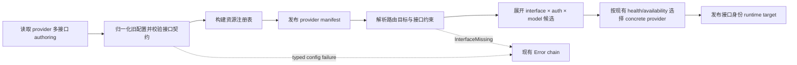
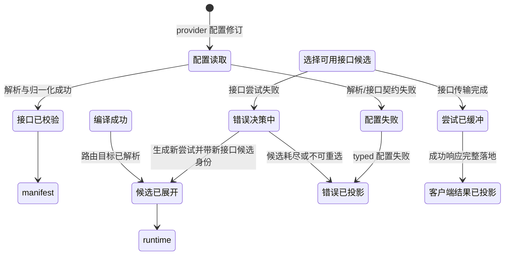

# V3 Provider 多接口架构设计

状态：实现候选；DAG 图已通过独立 review，正在完成候选验证与实现 review。
基线：`origin/main` `d9b6528ca36d43f503a2b00a9fafabdaf48e4c3e`。
DAG：`docs/architecture/dagpipe/graphs/provider-multi-interface-wiring.graph.json`。

## 目标

目前一个 V3 provider 只能声明一个 `type` 和一个 `baseURL`，路由展开时一个 provider/model/auth 只产生一个候选。本次架构修改的目标是：

- provider 配置允许声明多个接口，每个接口有自己的协议类型和 endpoint。
- 路由接线时按接口展开候选，每个接口生成一个独立的 runtime 候选。
- 每个接口候选携带独立 endpoint、协议、Responses transport 与兼容契约。
- provider/auth/model 仍共享；健康、冷却、诊断按接口细分，避免一个接口失败污染其他接口。
- provider 级并发预算保持聚合：`maxInFlight` 仍按 provider+authAlias 计算，`interfaceId` 只做归因和诊断，不复制预算。
- 旧单接口配置完全兼容，编译后归一为 `default` 接口。

这里的 runtime 不是新进程或新 daemon，而是 target/runtime 中一个带接口身份的 provider 候选与传输目标。每个接口候选最终进入现有 Direct/Relay、wire、transport、error 链路。

## 现状审计

单接口假设分布在以下 owner，后续实现按这个清单收敛，不新增第二套 provider 真相：

| 层 | 现状 | Owner |
| --- | --- | --- |
| V2 provider 文件解析 | `provider/<id>/config.v2.toml` 只有 `type`、`baseURL` | `routecodex-v3-config/provider_config.rs` |
| 原生 inline provider 解析 | `V3ProviderAuthoringConfig` 只有 `provider_type`、`base_url` | `routecodex-v3-config/types.rs` |
| manifest | `V3ProviderManifest` 只有 `provider_type`、`base_url`、共享 `responses` | `routecodex-v3-config/types.rs`、`validate.rs` |
| 路由目标 | `V3RoutePoolTargetManifest` 无接口约束 | `routecodex-v3-config/types.rs`、`validate.rs` |
| 路由计划 | `V3Router07OpaqueTargetPlanEntry` 无接口，`semantic_target_key` 不含 interface | `routecodex-v3-virtual-router/src/lib.rs` |
| Target 展开 | `expand_provider` 按 provider 直接造一个候选，候选键为 provider:auth:model | `routecodex-v3-target/src/lib.rs` |
| Runtime 接线 | `V3TargetCandidate` 只有单一 `provider_type`、`base_url` | `routecodex-v3-target/src/lib.rs` |
| Provider target | `V3ResponsesProviderTarget` 只有单一 provider/type/base_url | `routecodex-v3-provider-responses/src/wire.rs` |
| transport/probe | URL 直接从单一 `base_url` 构造 | `routecodex-v3-provider-responses/src/transport.rs`、`probe.rs` |
| health/cooldown | 身份只有 provider/auth/model，无接口维度 | `routecodex-v3-provider-responses/src/health.rs`、`global_cooldown.rs`、`provider_cooldown_probe.rs` |
| 全局 probe | 从 provider manifest 选第一个 model 构造单一 target | `routecodex-v3-runtime/src/provider_failure_global_probe.rs` |
| 管理面 | provider list/detail 只暴露单一 base_url | `routecodex-v3-admin/src/api/providers.rs` |

## 配置契约

新形式在 provider 文件根级不再使用单个 `type`/`baseURL`，改为 `[provider.interfaces.<interface-id>]`：

```toml
version = "2.0.0"
providerId = "multi"

[provider]
id = "multi"
enabled = true
defaultModel = "gpt-5"
compatibilityProfile = "chat:test"

[provider.auth]
type = "apikey"
entries = [{ alias = "primary", env = "MULTI_KEY" }]

[provider.models."gpt-5"]
wireName = "gpt-5"
capabilities = ["text", "tools"]
supportsStreaming = true

[provider.interfaces.responses]
enabled = true
type = "responses"
baseURL = "https://openai.example/v1"
responses = { process = "chat", streaming = "always", transport = "http" }

[provider.interfaces.chat]
enabled = true
type = "openai_chat"
baseURL = "https://chat.example/v1"

[provider.interfaces.anthropic]
enabled = false
type = "anthropic"
baseURL = "https://anthropic.example"
```

旧形式保持不变：

```toml
[provider]
type = "responses"
baseURL = "https://api.example/v1"
defaultModel = "gpt-5"
```

编译时若 `interfaces` 为空，则用旧 `type`/`baseURL`/`responses` 合成接口 ID `default`。若 `interfaces` 非空，则禁止与旧 `type`/`baseURL` 同时出现，避免双真源。

接口归一化和校验进入现有 `V3Config02AuthoringParsed -> V3Config03SchemaValidated -> V3Config04ResourceRegistryBuilt -> V3Config05ManifestPublished` 编译链；接口列表是现有 provider manifest 的字段，不新增第二个 manifest 写入者。

发布后的 manifest 是单源形状：多接口 provider 的标量 `provider_type`、`base_url`、`responses` 不再作为第二真源保留；现有标量消费方改为从选定的/default 接口派生。旧单接口 provider 的 `default` 接口仍可保留等价标量值。

每个接口契约：

- `type`：`responses`、`openai_chat`、`anthropic`、`gemini` 之一。
- `baseURL`：该接口独立 endpoint，必填且非空。
- `enabled`：默认 `true`；provider 必须至少有一个启用接口。
- `responses`：仅 `responses` 接口需要，支持独立 `process/streaming/transport/websocket_v2_url`。
- `compatibility_profile`：可选接口覆盖；缺省继承 provider 级默认。

## 路由契约

路由目标新增可选 `interface` 字段：

```toml
[route_groups.primary.pools.default]
targets = [
  { kind = "provider_model", provider = "multi", model = "gpt-5", interface = "chat", priority = 1 },
  { kind = "provider_model", provider = "multi", model = "gpt-5", priority = 2 },
]
```

- 声明 `interface`：只展开该 provider 的对应接口；缺失或停用返回 typed `InterfaceMissing`，不静默换接口。
- 未声明 `interface`：展开该 provider 全部启用接口，每个接口成为一个独立候选。
- forwarder 内嵌 `provider_model` 目标同样支持 `interface`。
- `interface` 必须从 authoring 传入 `V3Router06SelectionPlanTier`/`V3Router07OpaqueTargetPlanEntry`，并纳入 `semantic_target_key`/candidate dedup key；provider/model 相同但 interface 不同的目标不能折叠。

候选身份统一从 `provider:auth:model` 改为 `provider:interface:auth:model`。`V3TargetCandidate` 新增：

```rust
pub interface_id: String,
pub provider_type: String, // 来自接口
pub base_url: String,      // 来自接口
pub responses_process: Option<String>,
pub responses_transport: V3ResponsesTransportKind,
pub websocket_v2_url: Option<String>,
pub compatibility_profile: Option<String>,
```

`V3ResponsesProviderTarget` 同步新增 `interface_id` 和接口级 `compatibility_profile`；缺省时由 provider 级 compatibility 回填。Direct/Relay 判定继续按候选 `provider_type` 决定；每个接口候选独立走 wire、transport 和 probe。

## 身份、并发与失败边界

- `interface_id` 是 typed control/target identity，不进入 request、response、provider payload、MetadataCenter 或 Debug payload。
- 健康、冷却、probe 和持久化身份扩展为 `providerId + interfaceId + authAlias + modelId`；旧 key 缺少接口维度时迁移为 `default`。健康状态仍只由现有 `V3ProviderHealthStateMutated` 和 `V3ProviderHealthStore` 的失败、成功、probe 路径写入，候选展开节点不得写健康或冷却状态。
- 请求局部失败排除键同样扩展为 `providerId + interfaceId + authAlias + modelId`；`request_local_provider_failure_scope` 和 `expand_request_local_provider_failure_scope` 对接口局部 transport 失败只排除该接口候选，不排除同 provider 的其他接口。provider 级健康冷却仍由现有 health mutation 路径按接口身份处理。
- 并发准入身份保持 `providerId + authAlias`；`interfaceId` 只用于日志、诊断和归属展示。一个 provider 的多个接口共享同一个 `maxInFlight` 软预算，不得因为接口数量复制预算。
- `v3.provider.transport_request` 继续由 `V3Transport13ResponsesHttpRequest` 唯一写入；接口候选只提供 `base_url`、`provider_type` 和 transport/profile 控制事实，不新增 transport 资源写入者。
- 涉及接口身份的现有 map 资源必须在实现前更新 identity：`v3.route.opaque_target` 路由计划条目、`v3.target.candidate_set`、`v3.target.concrete_provider`、`v3.provider.transport_request`、`v3.provider.key_health_state`、`v3.provider.cooldown_probe_state`、`v3.provider.availability_projection`、`v3.provider.scheduling_projection`。写入者保持不变，identity 增加 `interfaceId`。`docs/architecture/v3-resource-operation-map.yml` 和 `docs/architecture/v3-mainline-call-map.yml` 须同步绑定。
- 配置解析和接口契约失败由 `V3Config02/V3Config03` 抛入现有 Error chain；路由目标声明了不存在或停用的接口时，`resolve_route_interface_scope`/`expand_interface_candidates` 返回 typed `InterfaceMissing`，由现有 `V3Error03TargetLocalAction` 接管。失败路径属于已注册的 `v3.operation_runner.error` 图，不是本成功对象图的第二个输出。

## DAG



节点粒度与 owner 映射：

| 节点 | 业务责任 | 现有 owner / resource |
| --- | --- | --- |
| `parse_provider_interface_authoring` | 读取并解析 provider 配置修订 | `V3Config02AuthoringParsed` / `v3.config.authoring_parsed` |
| `normalize_and_validate_provider_interfaces` | 归一化旧单接口并校验接口契约 | `V3Config03SchemaValidated` / `v3.config.schema_validated` |
| `build_provider_interface_registry` | 构建包含接口声明的资源注册表 | `V3Config04ResourceRegistryBuilt` / `v3.config.resource_registry` |
| `publish_provider_interface_manifest` | 发布唯一 provider manifest | `V3Config05ManifestPublished` / `v3.config.published_manifest` |
| `resolve_route_interface_scope` | 解析路由目标接口约束；扩展 `V3Target08KindClassified`，新 operator 签名同时接收 provider-interface-manifest 并读取 `v3.route.opaque_target`，不复用只接收 route 的现有 `classify_kind` | `V3Target08KindClassified` / `v3.route.opaque_target` |
| `expand_interface_candidates` | 展开全部/指定接口候选 | `V3Target09CandidateSetExpanded` / `v3.target.candidate_set` |
| `select_interface_concrete_provider` | 按现有 health/availability 选择具体候选 | `V3Target10ConcreteProviderSelected` / `v3.target.concrete_provider` |

图输出 `interface-runtime-target` 对应 `v3.target.concrete_provider`；失败边由现有 Error 图拥有，不在本 SESE 图中产生第二个出口。

## 接口生命周期状态



## 兼容与迁移

- 旧单接口配置解析结果不变；manifest 中接口列表恒为 `{"default": {...}}`。
- 健康/冷却持久化 schema 升级：旧 key 缺少接口维度时迁移为接口 `default`；已移除接口的旧 key 在迁移时丢弃。
- 管理面 provider 列表改为返回接口列表；`/providers/:id/models` 探测需要显式 `interface_id` 参数或返回所有接口摘要。
- provider 级 auth、models、concurrency、timeout、headers 继续共享；接口级只拥有协议、endpoint、Responses transport 与兼容契约。
- 不把接口信息放入业务 payload；`interface_id` 只作为 typed control resource / target candidate 身份。

## 受影响范围与实现顺序

0. DAGPipe 治理注册：`docs/architecture/dagpipe/modules.json`、`scripts/architecture/verify-v3-dagpipe-governance.mjs` 递归覆盖 `graphs/`。
1. Config 类型与编译：`provider_config.rs`、`types.rs`、`validate.rs`、`provider_directory.rs`。
2. Router plan 与 target 身份：`routecodex-v3-virtual-router/src/lib.rs`、`routecodex-v3-target/src/lib.rs`。
3. Provider wire/transport/probe：`wire.rs`、`transport.rs`、`probe.rs`。
4. Runtime Direct/Relay 接线：`kernel.rs`、`hooks.rs`、`hub_v1/*relay_runtime*`、`provider_failure_runtime_policy.rs`、`kernel/direct_runtime_helpers.rs`、`provider_failure_global_probe.rs`。
5. Health/cooldown/persistence：`health.rs`、`key_health.rs`、`global_cooldown.rs`、`provider_cooldown_probe.rs`。
6. Admin/CLI/diagnostics：`providers.rs`、`diagnostics.rs`、CLI provider init/status。
7. 测试与证据：config contract、target expansion、transport、probe、health persistence、并发预算、Direct/Relay controlled replay。
- Map/owner 同步：`v3-resource-operation-map.yml`、`v3-mainline-call-map.yml`、`v3-function-map.yml` 的接口身份绑定与 gate。
- 单源 manifest 消费同步：`v3/crates/routecodex-v3-config/src/validate.rs`、`v3/crates/routecodex-v3-runtime/src/provider_failure_global_probe.rs`、`v3/crates/routecodex-v3-admin/src/api/providers.rs`。

## 验收证据

- `dagpipe graph validate docs/architecture/dagpipe/graphs/provider-multi-interface-wiring.graph.json` PASS。
- `npm run verify:v3-dagpipe-governance` 覆盖 `provider_interface` 并递归扫描 `graphs/`。
- `npm run verify:v3-resource-map` PASS。
- 多接口 provider 配置与旧单接口配置同时通过 `rccv3 config check`。
- `V3Target09CandidateSetExpanded` 对多接口 provider 无 `interface` pin 时产生 `N` 个候选，每个候选接口身份/endpoint 不同。
- 指定 `interface` pin 只产生该接口候选；缺失/停用接口返回 typed error 并进入现有 Error 图。
- Router 对同 provider/model 不同 `interface` 的两个目标不做 dedup 折叠；`semantic_target_key` 含 interface。
- Direct 与 Relay 各自按接口 endpoint 发送真实受控上游请求，provider-request 样本包含接口归属。
- 一个接口失败冷却后，另一接口仍可用；持久化 key 含接口维度并可重启迁移。
- 同一 provider 的两个接口同时候选时，接口 A 的 transport 失败只排除 A，当前请求仍可回退到接口 B；回归测试覆盖请求局部排除键。
- 多接口不会放大 provider+authAlias 的 `maxInFlight` 预算；接口级指标只做归因。
- admin/CLI 可读接口列表与逐接口 health/endpoint。

## 非目标

- 不实现 per-interface auth、per-interface model 白名单或 per-interface headers；这些可后续在接口结构上扩展。
- 不改透明代理 payload 语义；接口只改变 provider 候选的协议/endpoint 归属。
- 不新增第二个 runtime 进程或第二套 provider 概念。
