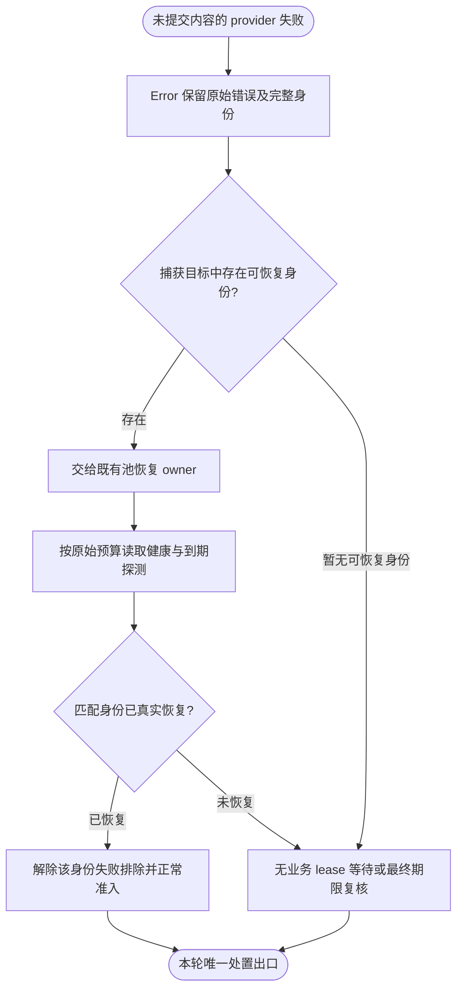
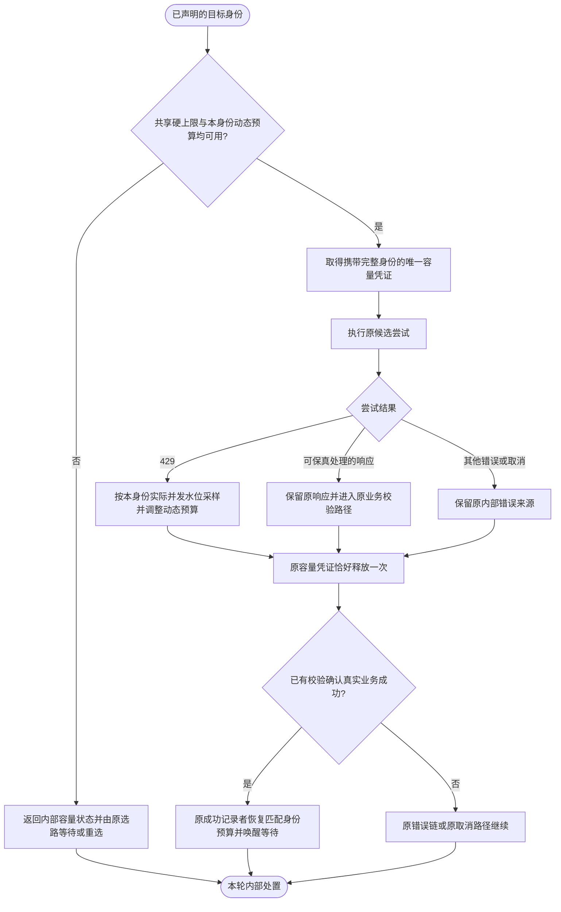
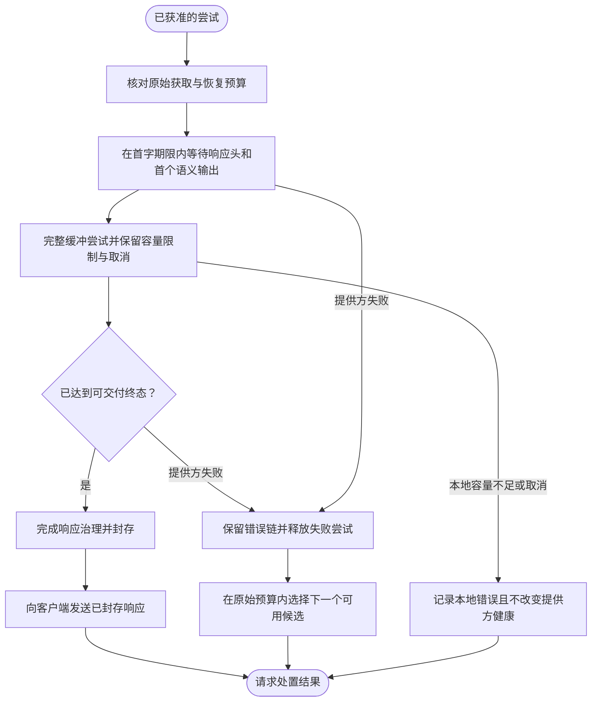
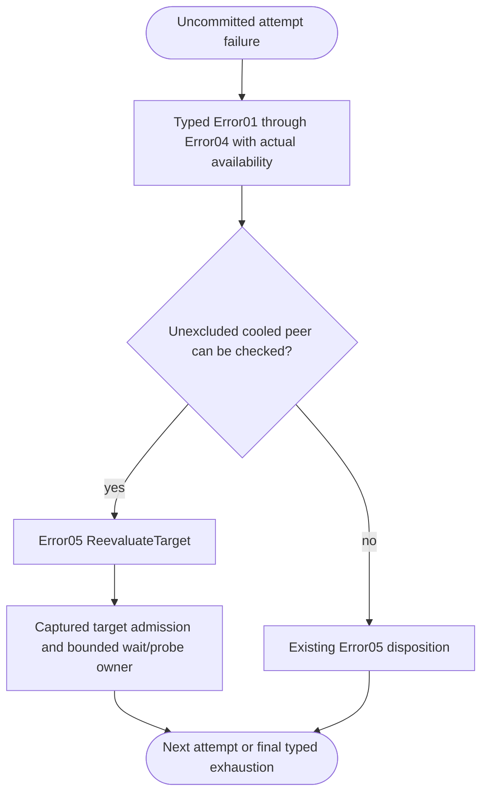
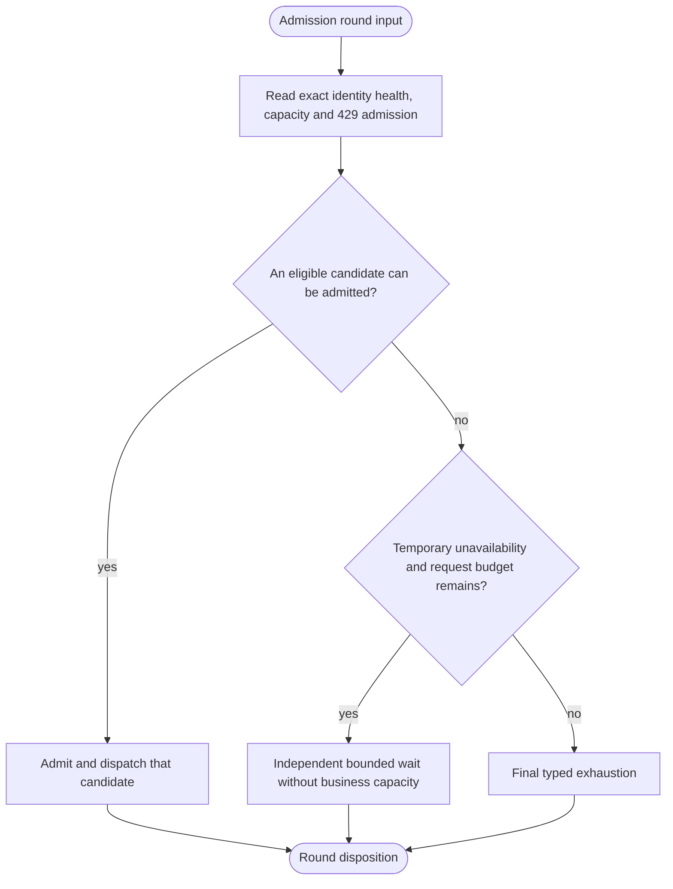
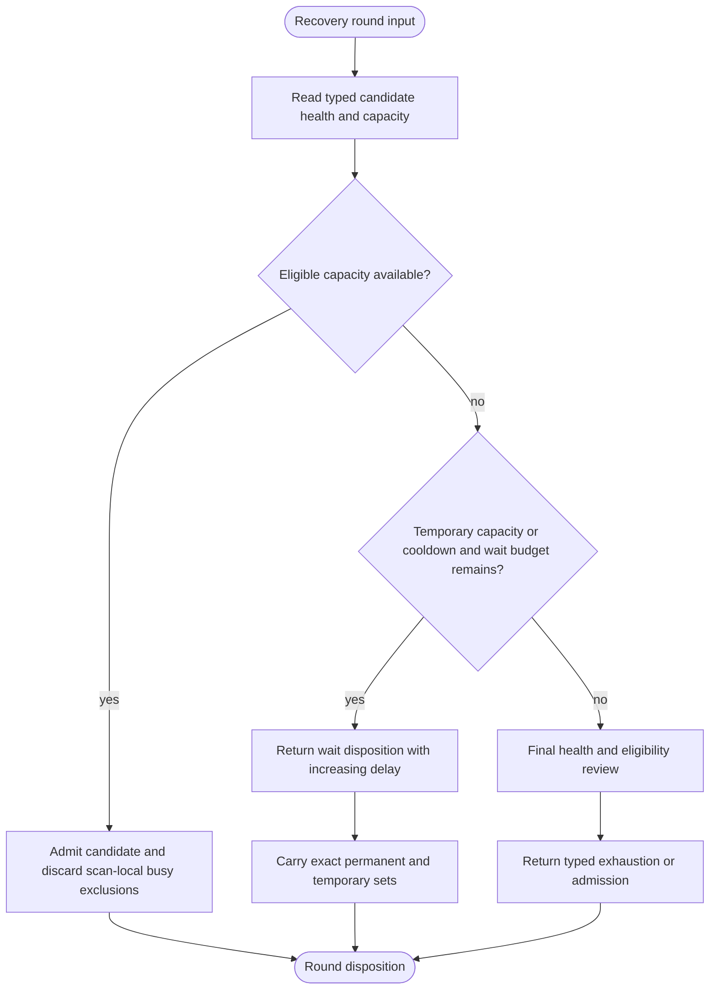
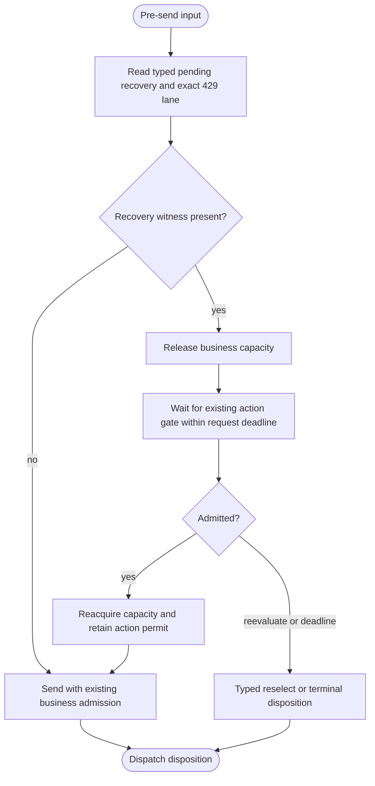

# 44cc3af: recovery waiting before terminal exhaustion

## Current policy

The user's later instructions override the historical policy below. Business
concurrency control and shared concurrency waits are removed; requests remain
independent. Three consecutive real 429 responses cool the exact identity only
for that session, starting at 10 seconds. Subsequent real 429 responses double
the cooldown, and from the tenth real 429 probes run once per hour until the
Beijing midnight reset. Across sessions, ten consecutive real errors trigger
identity-wide cooldown; when the triggering error is 429, the interval from
the first to the latest real 429 must exceed two minutes. Matching real session
success or a valid matching probe restores the identity across sessions. While
recovery remains possible, accepted requests stay open; only after all eligible
route tiers and declared route priorities are exhausted do they wait with
keepalive.

## Historical pool-empty recovery design (superseded where it differs)

### Sustained 429 policy override, 2026-10-26

Early 429 remains exact-identity capacity backpressure. A new real 429 spanning
at least two minutes since the first unresolved 429 commits a 30-minute minimum
cooldown. Matching real success resets the unresolved observation before a
probe-required disposition is established. Count alone and elapsed time without
a new provider response cannot upgrade the observation. After one hour of the
same unresolved episode, restoration requires a current exact-identity probe
returning a real non-429 HTTP response. Other HTTP failures remain failures in
the Error chain; no status or transport error is rewritten as success. Recovery
must satisfy the minimum and all remaining health restrictions. The existing
Store and probe owner carry and persist this typed state; no second scheduler
or payload control fields are introduced. Healthy alternatives remain usable.

### Independent request admission round

One round takes the captured target and the exact listener/provider/interface/
model/key control state. It returns one typed disposition: admit, wait, reselect,
or cancel/deadline. A waiting request holds no business lease. An in-flight
request's recovery permit must not by itself prevent another request from using
remaining declared capacity. Cancellation, success, failure and late permit
release are associated with their own attempt; an old release must not alter a
newer successful transition. The shared maxInFlight limit and the original
recovery deadline remain authoritative. The round does not reenter the router.

The action-gate tests must reject both cross-request serialization while
capacity remains and premature recovery or loss of another live attempt's state.
The public entry must prove that a second request reaches a controlled upstream
before the first is released, and separately enforce the shared capacity limit.

### 4945 public-entry gap: every captured candidate failed transport

Real7777 request `openai-responses-router-gpt-5.5-20261026T030605800-1712330-7383`
failed after connection refusal, response-header timeout and TLS EOF. Each
attempt had no upstream HTTP status. Internal502 is diagnostic, not provider
response data. Earlier all-cooled fixtures do not cover this all-tried path.
The current exclusion predicate filters every failed identity before deciding
whether pool recovery is possible, so it reaches the terminal exit instead.

The recovery handoff must include a previously failed identity whose existing
cooldown can recover. A matching typed successful probe or real business
success may release that identity's failure exclusion; elapsed time or an
unrelated wake cannot do so. Preserve request-shape exclusions, original
residence and acquisition budgets, exact identity isolation and cancellation.
Do not reenter Router or introduce another retry scheduler.

The protected last candidate is not cooled, probed or automatically retried.
Its failure does not immediately terminate the client request. With no other
recoverable peer the request remains pending without business capacity until
client cancellation or its original deadline; final checks then decide the
request transport disposition. A notification cannot release that protection.
Public regressions first prove waiting and recovery of a previously failed
candidate after every candidate suffered real transport failure, for native
Responses Direct and actual Responses-to-Chat Relay. They must distinguish a
matching probe success from spontaneous retry and forbid provider error bodies
or fabricated terminal success. No new last-candidate health amendment is
authorized. Before cooling another failed identity, hold it for observation in
typed control state, allow healthy alternatives immediately, and cancel its
pending cooling decision on matching real success. The existing declared
policy owns this timing; the pool wait ladder is not a new health threshold.
The probe permit is shared with the existing cooldown probe owner. Observation
does not manufacture a cooldown entry. Matching business success invalidates
the observation generation and cancels its transport. A late failure cannot
restore that pending action or cool the recovered identity. Other identities
do not share the observation lane or its timing escalation.
Candidate count is not a second transport-attempt ceiling. A recovered earlier
peer may receive the original request while the declared request attempt budget
and original deadline still allow it. Every real send retains its sequence;
the configured hard ceiling and existing 429 accounting remain enforced.

### PR489 combination: exact dynamic identity and shared hard ceiling

Keep the actual429 in-flight watermark, one-hour median-minus-one smoothing and
default40 configured ceiling. Dynamic samples, budgets and adaptive probe state
belong to the selected typed interface/model identity inside provider/auth.
The sum of all identity leases remains bounded by the shared configured ceiling.
429 on one identity never contracts another identity. The Error/action gate owns
retry timing; capacity admission owns the measured dynamic limit. This adds no
retry owner and no control fields to business payloads.

The existing request/error SESE graphs retain their operator order and separate
payload/error objects. The typed capacity resource and mapped lease lifecycle
carry the new identity dimension. Probe outcomes and early drops use their
existing owners; do not invent a second released flag, body-derived identity,
global adaptive budget or response-header business-success shortcut.

When no eligible candidate is presently available, each request independently
waits 1, 3, 15, 35 and 90 seconds, then rechecks every 1 second. These are
intervals, not cumulative deadlines or the provider health-probe ladder.
Matching health or capacity recovery wakes the request early. Notifications and
reselection retain the current scheduled due time; only interval expiry advances
the cursor. Each fresh request starts at the first step.

Pool recovery ends at the original request residence deadline or client
cancellation. Individual candidate acquisition and probe budgets remain
separate. A 60-second candidate acquisition budget cannot truncate this recovery
sequence. Waiting holds no business lease and cannot block unrelated requests.
HTTP429 still immediately switches to an eligible healthy alternative and
limits only its exact declared provider/interface/model/key identity.

Public Direct/Relay regressions cover successive fresh sessions after a prior
request exhausts, occupied capacity, all-cooled probes, recovery during a long
interval, cancelled capacity owners, cancellation and original request deadlines.
Complete-attempt buffering and active-stream lifetime work remain a separate
milestone under the same issue; this candidate delivers the pool recovery policy.
## Historical temporary pool exhaustion backoff

When the captured target has no presently eligible candidate, the request waits
asynchronously for 1, 3, 15, 35 and 90 seconds, then rechecks every 1 second.
These are per-request intervals, not cumulative deadlines or the provider's
health-probe ladder. A matching recovery or capacity release wakes the request
early so a healthy candidate can be used without waiting out a long interval.
Waiting holds no business-capacity lease and does not block other requests.
Every fresh request starts its own sequence. Client cancellation and the
original explicit request deadline remain effective.

The former candidate-acquisition-derived total recovery cutoff is inconsistent
with this policy: a 60-second acquisition timeout cannot execute its 90-second
interval. The independent pool-ladder amendment must resolve that boundary
before code changes. Single-candidate acquisition, 429 identity admission and
provider probe budgets must remain distinct; reselecting must never renew the
original request deadline. Earlier timing sections below describe the prior
implementation and its evidence, not the new interval contract.

## Live 4941 blocking stream failure: 9a4fc39 / 803d7ba

Original sample17175 failed again after 120007 ms while emitting business
deltas. Actual upstream status is unknown. Source shows a reqwest total body
timer and pre-terminal client projection; controlled public REDs must establish
each cause before implementation. The independent amended plan is retained in
the issue run as `plan-first-semantic-corrected.md`. No old PR379 code is copied.

The existing `responses-sse-client-frame-commit.graph.json` is topologically
SESE but its early-commit ordering violates the current full-attempt contract.
Its commit must follow complete terminal validation. Provider semantic progress
is internal attempt control and does not commit the client or prove success.

This graph describes one attempt/disposition round; subsequent attempts enter
through the same round. A failed attempt contributes zero client payload bytes.
Only the active attempt's stream timers disarm on semantic progress. Original
preplan, acquisition and recovery budgets never renew. Capacity and cancellation
remain enforced. Headers, comments and empty envelopes are not semantic progress.
The first focused gate is public `issue44cc3af_stream_*` under
`multi_listener_server`; it separates provider total timeout, runtime residence
timeout and pre-terminal leakage instead of changing several causes together.

## Follow-up: failure with only cooled peers remaining

4939 overall review identified incomplete caller coverage. Every Direct
Chat/Messages failure branch (HTTP failure, projection failure, buffered SSE
failure) must consume ReevaluateTarget as nonterminal. Wildcard terminalization
must become explicit terminal arms so a new recovery action cannot silently
become a client transport failure. Public Chat/Messages empty-SSE attempts with
a cooled recoverable peer guard this edge.

The live Responses protocol preplanner precedes execution. It must create the
single request execution-control resource before any wait, bound the complete
preplanning future by its deadline, and carry that same resource through the
separate typed return carrier into Direct or Relay seeds. Do not put execution
control into the protocol plan published to MetadataCenter. Synchronous diagnostic
plans carry no live execution control. Refresh the clock after every recovery sleep before the next selection
or due probe. Public initial-all-cooled tests cover both deadline expiry and
remaining execution time after a successful delayed probe.

Public Direct/Relay REDs `failed_attempt_waits_for_cooled_peer` show that the
failure policy can emit terminal Error05 before the existing planning wait owner
runs. A503 with B cooled must hand off to Target planning while B can recover
within the declared budget. This is separate from initial all-cooled admission.
The independent `plan-cooldown-followup.md` supports this handoff, with author
corrections: its success count and several symbol references are inaccurate;
the existing cooldown predicate already filters excluded candidates and must not
be rewritten. Do not infer eligibility from scheduling diagnostic labels.

Use an explicit typed `target_recovery_pending` Error04 fact and nonterminal
Error05 `ReevaluateTarget` action. Keep available-candidate count zero truthfully;
do not fabricate an available candidate or a provider-action admission witness.
Error policy excludes failed A, then the existing captured Target09 planning
owner waits/probes for B without holding capacity. Only matching successful
probe restores cooldown; time expiry alone does not. Preserve residence and
acquisition budgets, no retry of excluded A, and client cancellation.

User contract: 429 is backpressure, not sufficient health failure. Cross-session provider success preserves provider health. A full or all-cooled target waits with increasing backoff, preserving key eligibility and client cancellation, before final health review and terminal exhaustion. Original errors remain in the Error chain. No synthetic business completion.

## Current correction: identity eligibility before waiting

The user rejected the4937candidate because new requests waited on a selected
429identity while other healthy candidates were available. Production has been
restored to the verified4935pair. This correction supersedes the earlier
unconditional pre-send-wait interpretation below; those sections describe the
previous implementation and its regression history, not the new acceptance.

Only the exact `provider.model.key` (and declared interface identity) that returned
429 is constrained. Its backoff is not a server, route, pool or request-wide gate.
The current request immediately reselects a healthy alternative after429. Later
requests skip that constrained identity and independently use eligible B/C or
otherkeys/models, preserving their configured concurrency. Only a request with
no eligible alternative waits, without holding a business-capacity lease.

Configured `provider:auth` capacity remains shared across that key's models;
splitting the configured limit per model would multiply the allowed in-flight
requests. A business429 releases its capacity lease and enters the exact model's
typed Error/action gate. It must not decrement that shared capacity budget.
The independent `plan-model-budget.md` selects removal of this overlapping
transport mutation. Direct and Relay public REDs hold eight sibling-model
responses open after A429: both observe only seven slots before the change.
Keeping configured capacity while removing that mutation is the minimum fix.

Each admission round is SESE. New rounds reuse the captured target; they do not
reenter Router. A429→healthyB is an immediate typed reselect, not admission to A's
waiting lane followed by a B send. Selection/admission must avoid a read-then-wait
race that queues a burst on A while B is usable. Due recovery for A is coordinated
only on A and remains cancellable; real matching success restores normal A
parallelism. The exact permit ownership and existing-owner API changes are being
independently replanned before implementation.

Required new public REDs prove A429→B before an unrelated one-second backoff,
multiple later default requests concurrently reaching B/C while A is constrained,
and same-provider otherkey/model completing without that wait. Retain all-targets
waiting, bounded-storm, explicit-pin and cancellation coverage. Throughput and
unrelated-request progress are acceptance outcomes, not inferred from a final200.

Protocol preplanning captures the Router hit and pending route observation once. Recovery rounds reuse that hit and reselect only inside its target; waiting never reruns route policy evaluation or selects a different route pool.

The acquisition budget also bounds an awaited exhaustion rescue probe. When it expires, cancellation drops only this request's probe guard and preserves cooldown; a final typed selection observes any concurrent success before publishing exhaustion. A stalled probe cannot extend the request beyond this recovery budget. The same boundary applies to live protocol preplanning.

The whole planning future is also bounded by the existing request residence
deadline, including preplanning, recovery probes and target sleeps. This is the
same absolute deadline from typed request execution control, not a fresh timeout
on each re-selection. At expiry, drop only this request's future and publish a
typed `request_residence_deadline_exceeded` failure; do not consume an attempt or
change provider health. The Direct and Relay public residence cases reproduce
the missing bound: a 300ms request previously waited for a 2000ms acquisition
budget. They must terminate within 1000ms without client error payloads.

The missing edge is in `run_v3_plan_execution_with_recovery`: capacity exclusions and unsuccessful cooldown rescue currently return `Exhausted` immediately. A recovery round must instead return a wait decision while the existing declared candidate concurrency acquisition budget remains. Runtime executes the wait, drops only temporary capacity exclusions, then starts a new selection round. Permanent request exclusions remain. This reuses `concurrency_acquire_timeout_ms` rather than inventing an unconfigured terminal deadline. Health probes retain their global per-identity ownership. Exhaustion after this budget requires a final selection and due recovery check.

This is a SESE recovery round, not a static retry cycle. Runtime invokes subsequent rounds after wait. Cancellation drops the waiting future and any admission lease. Error03/04 must not confuse temporary capacity exclusion with irreversible request failure. Required public-entry gate: `node v3/scripts/run-v3-cargo-test.mjs -p routecodex-v3-server --test multi_listener_server issue44cc3af -- --nocapture --test-threads=1`.

The pre-send round also reads the existing exact-identity 429 lane for a fresh request. Its typed recovery witness comes from the live action-gate resource, never payload or logs. It enters the existing recovery transition, releasing business admission before waiting and retaining the admitted action permit through the send. Recovery waits, including already-failed requests, are bounded by the request residence deadline. Public REDs: `issue44cc3af_new_session_obeys_existing_429_backoff` and `issue44cc3af_429_gate_wait_obeys_request_residence_deadline`.

Direct 429 recovery must bind the Target Interpreter's selected alternative from the captured candidate set, temporarily excluding only the just-failed identity for that selection. Keeping a 429 identity routable must not cause priority selection to pick it again before an eligible alternative. If no alternative is available, the same identity remains eligible behind its backoff. Shared rate-limit scopes retain the full provider/interface/auth/model identity as their coordination-group discriminator, so another key's first failure cannot promote this key's backoff.

Order: bind this gate and obtain the old implementation's failing public-entry test before runtime changes. Then verify the same test passes, plus bounded upstream attempts and existing recovered-peer regressions. Full 429 control, cooldown waiting, cancellation and exhausted-budget coverage remain required before delivery.

Review correction: every admission disposition, including exhaustion, carries its
typed permanent-exclusion and temporary-busy sets to the next recovery round. An
exhaustion source label cannot reconstruct those sets: a prior failed candidate
and a currently busy healthy candidate are a mixed case that must still wait.
Temporary busy exclusions do not survive a completed admission transaction.
Before a selected plan escapes to a transport caller, remove those identities
from permanent exclusions and clear its busy set. A new async planning call or
selection after an actual probe phase rechecks busy identities by removing them
from exclusions. Probe-only metadata rounds retain their busy provenance until
admission or timed wait; they must not restart the probe's generation handshake.
Keep actual failed identities excluded.
This preserves the existing SESE round's two outcome edges without carrying
temporary capacity state into the request's failed-candidate history.

Each new client request owns a fresh declared acquisition budget even when a
previous request has exhausted its own recovery budget. Shared identity health,
capacity and probe ownership persist; a previous request's terminal disposition
must not become a server-wide admission rejection. The existing admission-round
graph is unchanged. Public Direct and Relay regressions cover successive new
sessions while both providers remain occupied and while all identities remain
cooled with stalled shared probes. Each request must wait independently, remain
bounded, and end transport detectably without business error payload or a normal
empty completion. Occupied providers must receive no additional business calls.
The required gate selects `issue44cc3af_*repeated*after_exhaustion*` and
`issue44cc3af_*repeated_all_cooled_requests*` in `multi_listener_server`.

Required public cases cover both Direct and Relay: A fails while B is occupied,
then B releases and succeeds; A is occupied while B is selected, then A releases
before B fails and the request recovers on A. Assert one failed-provider attempt,
no dispatch while capacity is held, complete business output after release, and
no error payload. These supplement the homogeneous all-busy cases.

The ordinary transport-attempt ceiling uses the captured Target09 candidate set,
not the currently selectable count on Target10. Temporary admission exclusions
can reduce that selectable count to one; freezing the attempt ceiling at one
would reject a later, untried candidate even after its capacity returns. Preserve
the configured request ceiling and residence deadline. Explicit pinned execution
without an expanded target retains its selected pinned candidate count.

Rechecking capacity after a probe phase must preserve the completed probe flags
when the same identity is still busy. A newly discovered busy identity resets
that phase as before. Otherwise an immediate repeated probe-initiation round
can spin without yielding and starve its own detached recovery probe and timer.
The existing Direct/Relay busy-preferred/cooled-peer public cases and the bounded
runtime `busy_preferred_candidate_preserves_cooled_peer_recovery` case guard it.

## Current request-local complete-scan correction

Probe is only the cooldown-health owner. It never joins business dispatch,
selects a candidate, or grants a recovered send. A request owns a short-lived
set of complete provider/interface/auth/model identities that reached its wire
send boundary in the current scan. Selection excludes that set in addition to
permanent request exclusions and typed health. Each eligible identity is sent
at most once per scan. Only full captured-pool exhaustion enters that request's
keepalive recovery. The wait registers the current availability generation;
either a later generation or the existing request recovery cadence clears only
the scan set and starts a new normal selection. It never clears permanent
request exclusions or provider cooldown.

The cumulative wire-attempt number remains diagnostic. The old fixed ordinary
attempt ceiling and the requirement for a newer recovery-success revision after
that ceiling are not dispatch authority: they can truncate a pool larger than
the configured count and can leave a request unable to produce its own recovery
success. Byte, frame, request and process resident-memory limits remain owned by
the attempt store. The focused Direct and Relay public regressions must prove
two failed identities are not sent again inside one scan, another session
progresses while the original waits, and the original starts a later legal scan
without a synthetic probe or pre-existing success receipt.
