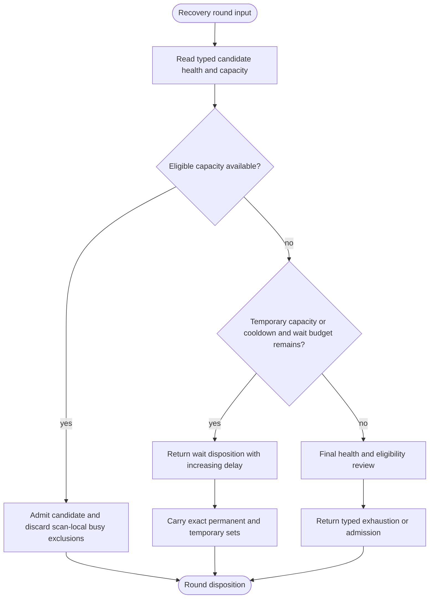
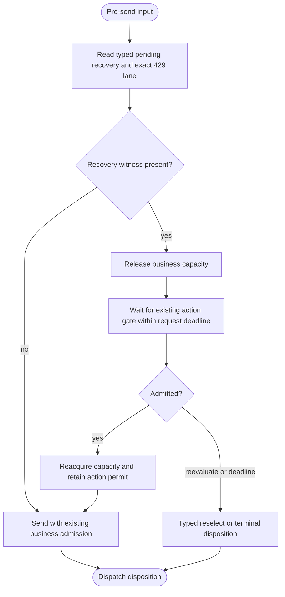

# 44cc3af: recovery waiting before terminal exhaustion

## Follow-up: failure with only cooled peers remaining

4939 overall review identified incomplete caller coverage. Every Direct
Chat/Messages failure branch (HTTP failure, projection failure, buffered SSE
failure) must consume ReevaluateTarget as nonterminal. Wildcard terminalization
must become explicit terminal arms so a new recovery action cannot silently
become a client transport failure. Public Chat/Messages empty-SSE attempts with
a cooled recoverable peer guard this edge.

The live Responses protocol preplanner precedes execution. It must create the
single request execution-control resource before any wait, bound the complete
preplanning future by its deadline, and carry that same resource through the
separate typed return carrier into Direct or Relay seeds. Do not put execution
control into the protocol plan published to MetadataCenter. Synchronous diagnostic
plans carry no live execution control. Refresh the clock after every recovery sleep before the next selection
or due probe. Public initial-all-cooled tests cover both deadline expiry and
remaining execution time after a successful delayed probe.

Public Direct/Relay REDs `failed_attempt_waits_for_cooled_peer` show that the
failure policy can emit terminal Error05 before the existing planning wait owner
runs. A503 with B cooled must hand off to Target planning while B can recover
within the declared budget. This is separate from initial all-cooled admission.
The independent `plan-cooldown-followup.md` supports this handoff, with author
corrections: its success count and several symbol references are inaccurate;
the existing cooldown predicate already filters excluded candidates and must not
be rewritten. Do not infer eligibility from scheduling diagnostic labels.

Use an explicit typed `target_recovery_pending` Error04 fact and nonterminal
Error05 `ReevaluateTarget` action. Keep available-candidate count zero truthfully;
do not fabricate an available candidate or a provider-action admission witness.
Error policy excludes failed A, then the existing captured Target09 planning
owner waits/probes for B without holding capacity. Only matching successful
probe restores cooldown; time expiry alone does not. Preserve residence and
acquisition budgets, no retry of excluded A, and client cancellation.

User contract: 429 is backpressure, not sufficient health failure. Cross-session provider success preserves provider health. A full or all-cooled target waits with increasing backoff, preserving key eligibility and client cancellation, before final health review and terminal exhaustion. Original errors remain in the Error chain. No synthetic business completion.

## Current correction: identity eligibility before waiting

The user rejected the4937candidate because new requests waited on a selected
429identity while other healthy candidates were available. Production has been
restored to the verified4935pair. This correction supersedes the earlier
unconditional pre-send-wait interpretation below; those sections describe the
previous implementation and its regression history, not the new acceptance.

Only the exact `provider.model.key` (and declared interface identity) that returned
429 is constrained. Its backoff is not a server, route, pool or request-wide gate.
The current request immediately reselects a healthy alternative after429. Later
requests skip that constrained identity and independently use eligible B/C or
otherkeys/models, preserving their configured concurrency. Only a request with
no eligible alternative waits, without holding a business-capacity lease.

Configured `provider:auth` capacity remains shared across that key's models;
splitting the configured limit per model would multiply the allowed in-flight
requests. A business429 releases its capacity lease and enters the exact model's
typed Error/action gate. It must not decrement that shared capacity budget.
The independent `plan-model-budget.md` selects removal of this overlapping
transport mutation. Direct and Relay public REDs hold eight sibling-model
responses open after A429: both observe only seven slots before the change.
Keeping configured capacity while removing that mutation is the minimum fix.

Each admission round is SESE. New rounds reuse the captured target; they do not
reenter Router. A429→healthyB is an immediate typed reselect, not admission to A's
waiting lane followed by a B send. Selection/admission must avoid a read-then-wait
race that queues a burst on A while B is usable. Due recovery for A is coordinated
only on A and remains cancellable; real matching success restores normal A
parallelism. The exact permit ownership and existing-owner API changes are being
independently replanned before implementation.

Required new public REDs prove A429→B before an unrelated one-second backoff,
multiple later default requests concurrently reaching B/C while A is constrained,
and same-provider otherkey/model completing without that wait. Retain all-targets
waiting, bounded-storm, explicit-pin and cancellation coverage. Throughput and
unrelated-request progress are acceptance outcomes, not inferred from a final200.

Protocol preplanning captures the Router hit and pending route observation once. Recovery rounds reuse that hit and reselect only inside its target; waiting never reruns route policy evaluation or selects a different route pool.

The acquisition budget also bounds an awaited exhaustion rescue probe. When it expires, cancellation drops only this request's probe guard and preserves cooldown; a final typed selection observes any concurrent success before publishing exhaustion. A stalled probe cannot extend the request beyond this recovery budget. The same boundary applies to live protocol preplanning.

The whole planning future is also bounded by the existing request residence
deadline, including preplanning, recovery probes and target sleeps. This is the
same absolute deadline from typed request execution control, not a fresh timeout
on each re-selection. At expiry, drop only this request's future and publish a
typed `request_residence_deadline_exceeded` failure; do not consume an attempt or
change provider health. The Direct and Relay public residence cases reproduce
the missing bound: a 300ms request previously waited for a 2000ms acquisition
budget. They must terminate within 1000ms without client error payloads.

The missing edge is in `run_v3_plan_execution_with_recovery`: capacity exclusions and unsuccessful cooldown rescue currently return `Exhausted` immediately. A recovery round must instead return a wait decision while the existing declared candidate concurrency acquisition budget remains. Runtime executes the wait, drops only temporary capacity exclusions, then starts a new selection round. Permanent request exclusions remain. This reuses `concurrency_acquire_timeout_ms` rather than inventing an unconfigured terminal deadline. Health probes retain their global per-identity ownership. Exhaustion after this budget requires a final selection and due recovery check.

This is a SESE recovery round, not a static retry cycle. Runtime invokes subsequent rounds after wait. Cancellation drops the waiting future and any admission lease. Error03/04 must not confuse temporary capacity exclusion with irreversible request failure. Required public-entry gate: `node v3/scripts/run-v3-cargo-test.mjs -p routecodex-v3-server --test multi_listener_server issue44cc3af -- --nocapture --test-threads=1`.

The pre-send round also reads the existing exact-identity 429 lane for a fresh request. Its typed recovery witness comes from the live action-gate resource, never payload or logs. It enters the existing recovery transition, releasing business admission before waiting and retaining the admitted action permit through the send. Recovery waits, including already-failed requests, are bounded by the request residence deadline. Public REDs: `issue44cc3af_new_session_obeys_existing_429_backoff` and `issue44cc3af_429_gate_wait_obeys_request_residence_deadline`.

Direct 429 recovery must bind the Target Interpreter's selected alternative from the captured candidate set, temporarily excluding only the just-failed identity for that selection. Keeping a 429 identity routable must not cause priority selection to pick it again before an eligible alternative. If no alternative is available, the same identity remains eligible behind its backoff. Shared rate-limit scopes retain the full provider/interface/auth/model identity as their coordination-group discriminator, so another key's first failure cannot promote this key's backoff.

Order: bind this gate and obtain the old implementation's failing public-entry test before runtime changes. Then verify the same test passes, plus bounded upstream attempts and existing recovered-peer regressions. Full 429 control, cooldown waiting, cancellation and exhausted-budget coverage remain required before delivery.

Review correction: every admission disposition, including exhaustion, carries its
typed permanent-exclusion and temporary-busy sets to the next recovery round. An
exhaustion source label cannot reconstruct those sets: a prior failed candidate
and a currently busy healthy candidate are a mixed case that must still wait.
Temporary busy exclusions do not survive a completed admission transaction.
Before a selected plan escapes to a transport caller, remove those identities
from permanent exclusions and clear its busy set. A new async planning call or
selection after an actual probe phase rechecks busy identities by removing them
from exclusions. Probe-only metadata rounds retain their busy provenance until
admission or timed wait; they must not restart the probe's generation handshake.
Keep actual failed identities excluded.
This preserves the existing SESE round's two outcome edges without carrying
temporary capacity state into the request's failed-candidate history.

Required public cases cover both Direct and Relay: A fails while B is occupied,
then B releases and succeeds; A is occupied while B is selected, then A releases
before B fails and the request recovers on A. Assert one failed-provider attempt,
no dispatch while capacity is held, complete business output after release, and
no error payload. These supplement the homogeneous all-busy cases.

The ordinary transport-attempt ceiling uses the captured Target09 candidate set,
not the currently selectable count on Target10. Temporary admission exclusions
can reduce that selectable count to one; freezing the attempt ceiling at one
would reject a later, untried candidate even after its capacity returns. Preserve
the configured request ceiling and residence deadline. Explicit pinned execution
without an expanded target retains its selected pinned candidate count.

Rechecking capacity after a probe phase must preserve the completed probe flags
when the same identity is still busy. A newly discovered busy identity resets
that phase as before. Otherwise an immediate repeated probe-initiation round
can spin without yielding and starve its own detached recovery probe and timer.
The existing Direct/Relay busy-preferred/cooled-peer public cases and the bounded
runtime `busy_preferred_candidate_preserves_cooled_peer_recovery` case guard it.
