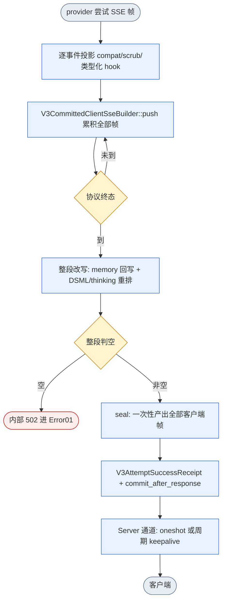
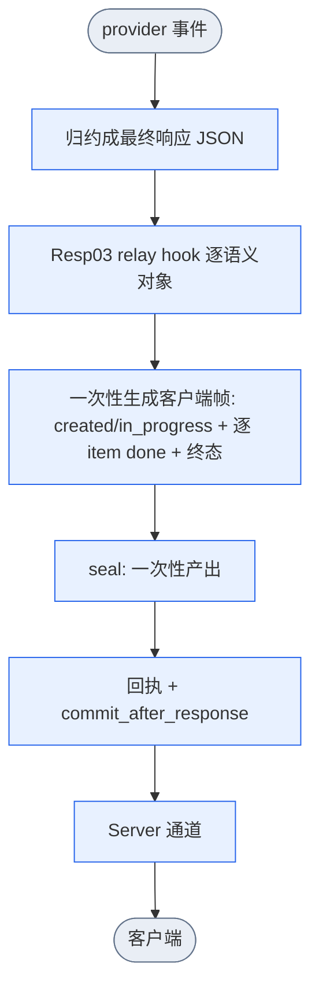
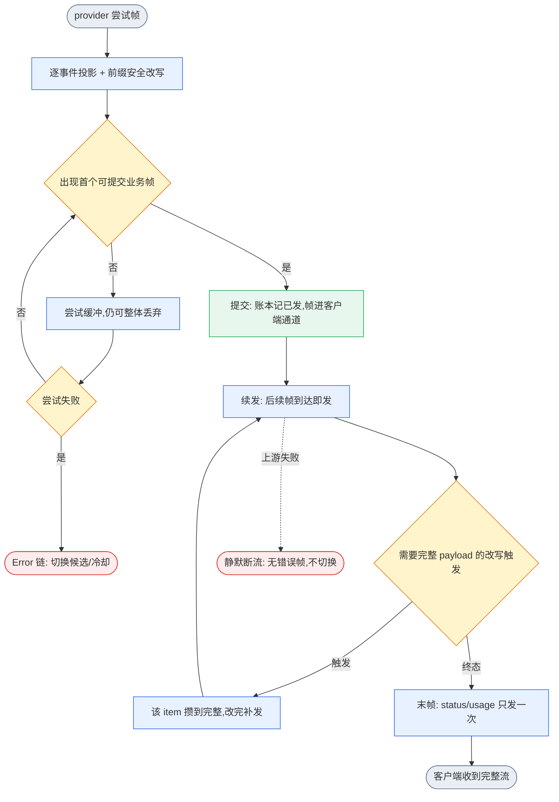

# 首帧提交:受影响的 DAG、gap 与计划(issue 849ed8f)

范围:客户端响应提交边界。Direct 与 Relay 两条路共用同一出口,今天都只在终态后一次性外送。

真相源:`docs/architecture/dagpipe/*.graph.json`(静态图)、`v3-resource-operation-map.yml`(资源与语义合同)、
`v3-function-map.yml`(owner)、`v3-mainline-call-map.yml`(调用边)、`v3-verification-map.yml`(gate)。

## 1 现状 DAG

### 1.1 Direct(入口协议 == provider 协议)

锚点:`direct_runtime_helpers_stream.rs:272-340`(逐帧 push)、`:366/:414`(memory 整段回写)、
`:375/:421`(整段响应 hook)、`:381/:427`(seal)、`v3_direct_core.rs:1196`(收集调用)、
`:1388-1391`(body 与回执)、`:1531-1546`(commit_after_response)、
`client_sse_transport.rs:57-74`(只接一个 future 与一个 oneshot)、`:203-296`(keepalive 与 splice)。

### 1.2 Relay(跨协议)

锚点:`provider_stream_materialization.rs:8-37`(事件归约),`responses_relay_runtime.rs:740-829`
(created/in_progress、逐 item `output_item.done`、终态与 usage)。

### 1.3 已登记的静态图与真实接线的差

`v3.operation_runner.response.graph.json` 是 5 节点、全 `Whole` 迭代器的 JSON 链
(`adjust_provider_private_response → normalize_provider_response → govern_chat_response →
inverse_project_client_response → frame_committed_client_response`),单出口 `client-frame-candidate`。
它描述一次完整响应对象,不含 SSE 流、尝试缓冲、seal、提交边界与传输通道。
`dagpipe graph inspect` 只能证明这条链的 SESE,证明不了上面两条真实流。

## 2 目标 DAG(首帧提交)

两条路在提交点汇合;提交点之前仍是单出口。

## 3 Gap

| ID | gap | 证据 | 级别 |
| --- | --- | --- | --- |
| G1 | 静态响应图不含流式与提交边界,`client-frame-candidate` 语义是整段对象,首帧提交后它变成增量流 | `v3.operation_runner.response.graph.json`(5 节点全 Whole);`dagpipe graph inspect` 只验链形 | 阻断 |
| G2 | 尝试缓冲资源被钉死为整段准入,且禁止 Server 写入,首帧提交需要第二个资源承载已发帧 | `v3-resource-operation-map.yml:3068-3100`:`v3.sse.direct.full_attempt_buffer`、`may_enter_client_body: false`、`forbidden_writers: [routecodex-v3-server...]`、`semantic_contract.whole_attempt_admission` | 阻断 |
| G3 | 整段改写会替换/删除更早的帧,首帧外送后无法回改 | `direct_response_hooks_dsml.rs:570-729`(终态建关联后按 plan 替换 `output_item.added/done`、`content_part.*`、`output_text.delta/done`);`direct_response_hooks_dsml.rs:197-300`(按 item 扫描 markup,`changed` 为假则原样保留);`direct_runtime_helpers_stream.rs:563-679`(memory 回写);`direct_response_thinking_compat.rs:116-219` | 阻断 |
| G4 | 成功回执语义是"完整载荷已封存",提交后失败没有对应的 typed 出口与终态分类 | `execution_control.rs:407-435`(`V3AttemptSuccessReceipt` 私有构造只按终态封存)、`:700-723`(seal 才设 `terminal_frame_index`)、`frame_builders.rs:557-640`(Dropped/Completed 记账) | 阻断 |
| G5 | Server 通道只有 oneshot,没有增量帧通道、首帧后 keepalive 归属、断开中止 | `client_sse_transport.rs:57-74`(单 future + 单 oneshot)、`:203-296`(`AwaitOutcome`/`Drain`/`FrameCommittedPayload`/`Close` 都是整段态) | 阻断 |
| G6 | Relay 没有事件到客户端帧的推导,只有终态整段生成 | `provider_stream_materialization.rs:8-37`;`responses_relay_runtime.rs:740-829` | 阻断(P2) |
| G7 | 契约文本钉死"提交前完整缓冲",验收条款仍写"提交后失败不可达" | `AGENTS.md:53` 与 `:63`;`wiki/v3-direct-sse-accept-skeleton.md:48-58,91`;`wiki/v3-client-sse-head-commit.md:10,86-91,154`;`v3-unified-operation-runner-design.md:217`;`v3-verification-map.yml:3637-3643`(accept skeleton `required_negative` 第 4 条) | 阻断(P0) |
| G8 | 生成面按旧拓扑生成,手改无效 | `wiki/v3-mainline-caller-flow.md:3507-3525`(子图 `v3.responses_direct_full_attempt_commit`、`v3-direct-sse-full-attempt-buffer`) | 阻断(P4) |
| G9 | 共享 collector 同时服务 chat/gemini/anthropic Direct 与 JSON 塌缩路径,改动外溢 | `v3_direct_core.rs:1147-1391`、`direct_client_sse_collapse.rs`、`v3-verification-map.yml:3632`(`openai_chat_direct_sse_` gate) | 应修 |
| G10 | 没有"首帧到达时间"与"续发不重复"的红测与 gate | 现有 gate 只断言终态与整段字节(`v3-verification-map.yml:3632-3643`) | 应修 |

## 4 计划

按 gap 闭合顺序推进;每个阶段先红测再实现,阶段内不跨 owner。

### P0 图与契约(不改行为)

1. 重画响应静态图:`frame_committed_client_response` 拆为 `first_frame_commit`、`continue_append_only`、`terminal_closeout` 三节点,
   出口 `client-frame-candidate` 改为增量流 ARC,并保留单入口单出口。
2. 资源表新增 `v3.sse.client_frame_ledger`(identity `[requestId, attemptId, providerKey, protocol]`,
   writer `V3CommittedClientSseBuilder::flush` / `::seal_remainder`,reader `V3ClientSseChannelStream`);
   `v3.sse.direct.full_attempt_buffer` 语义改为 pre-commit only,`may_enter_client_body` 留给账本。
3. 改 G7 全部文本,并把 `v3-verification-map.yml` 中"提交后失败不可达"改成"提交后失败静默断流,不换候选,不冷却其它身份"。
4. 证据:`dagpipe graph validate` + `dagpipe graph inspect`、`npm run verify:v3-dagpipe-governance`、
   `npm run verify:v3-resource-map`、`npm run verify:v3-module-boundaries`。

### P1 Direct 首帧提交(主线,解决 tok/s 失真)

1. 红测(先失败):分段延时的 mock provider,断言第 1 个业务帧在终态前到达客户端通道;
   断言账本外送 + seal 剩余拼起来与整段路径逐字节相等。
2. 实现:builder 记 `flushed_frames`,`push` 后立即 flush;`seal_after_validated_terminal` 从 `flushed_frames` 起回放;
   整段改写在 `flushed_frames > 0` 时显式拒绝(`ensure_fully_buffered`),不给静默降级。
3. 提交判定复用 `has_business_content`;`commit_client_stream` 只在无整段改写依赖时调用,依赖由
   manifest/请求级判定(memory 捕获、DSML 上下文、thinking 模板)。
4. Server:`accept_v3_client_sse_transport` 增加帧通道,首帧后停 keepalive、接管断开中止;
   提交后失败返回静默断流,不发状态帧或错误帧。
5. 回执与终态:新增 attempt-committed 边界;提交后失败走 Dropped 类,不产生成功回执,只按精确
   `provider.model.key` 记录健康与冷却。
6. 证据:`cargo test -p routecodex-v3-runtime --lib first_frame_commit`、
   `cargo test -p routecodex-v3-server --lib client_sse_first_frame_channel`、
   既有 `direct_sse_full_attempt_commit` 与 `openai_chat_direct_sse_` 保持绿。

### P2 Relay 逐事件出帧

现状(0.90.4935 实测):Relay 的客户端帧只在整段归约后一次性产出。`responses_relay_runtime.rs:805-930`
对 message item 只发 `output_item.done`,不发任何 `output_text.delta`;因此即使不缓冲也没有渐进显示。
7777 真实回放(relay,openai_chat 线协议)在 49.89s 一次性收到
`created / in_progress / output_item.done × 4 / completed`,共 7 帧。

1. 逐事件映射(先 openai_chat,再 anthropic / gemini):
   `delta.content` → `output_text.delta`(配 `output_item.added` + `content_part.added` 生命周期);
   `delta.reasoning_content` → 推理摘要增量;工具调用 `function.name` 出现即 `output_item.added`,
   参数增量挂起到块完整再发;`finish_reason` 关闭 open item;终态补 usage。
2. 提交边界与 Direct 同构:首个业务帧(可见输出文本增量或带名字的 tool-call 起始帧)提交,
   提交前仍是整段缓冲,可整体丢弃;提交后续发 append-only,提交后失败静默断流,不换候选。
3. 治理闸:Relay 的 Resp01/02/03 与 Chat Process 在整段上运行。凡请求级证明会改写文本或工具形状的
   (tool thinking、DSML、memory raw capture、声明了响应侧改写的 provider compat 档),不提交并保持
   今天的整段缓冲,逐字节不变;只有证明不改写的请求才渐进投影。终态帧仍由整段 builder 产出
   (usage/status 只发一次)。
4. 服务端复用 `V3CommittedClientFrameSink` 与 `accept_v3_client_sse_transport`:首帧提交后通道接管,
   outcome 只补 `flushed_frames` 之后的剩余帧。
5. 红测:同一 chat SSE 事件流在 relay 路径必须于 provider 终态前把首个 `output_text.delta`
   送到客户端通道;并断言工具参数字节挂起到块完整。
6. 证据:`cargo test -p routecodex-v3-runtime --lib relay_first_frame_commit`、真实入口 7777 到达时间分布。

状态(P2 进行中,未合入):逐事件投影已落在 `responses_relay_runtime/relay_client_frames.rs`。
openai_chat 线协议按上述映射逐帧出帧;提交谓词与 Direct 同构;工具参数挂起到 item 完成;
终态帧在 seal 边界内。Relay refill 循环按请求持有同一投影状态,只在最终轮按合并后的响应
seal 一次,避免提交后被下一轮重投影覆盖。请求级不提交条件为 memory raw capture 或
tool thinking。gate `cargo test -p routecodex-v3-runtime --lib relay_first_frame_commit` 两条已绿,
关闭提交谓词时两条同时红。受影响 relay 套件 197/197 绿。尚未做:真实入口 7777 逐帧到达时间
回放、构建安装重启、独立 review、合入与远端回执。

### P3 完整性闸(工具参数与整段改写)

1. 工具参数改写、custom tool 按帧逐个应用,保持前缀安全;需要完整 JSON 的只在 block 完整点发。
   `strip_client_response_id` 已由 Direct SSE content consumer 在传输层后、客户端投影前逐帧应用,
   不属本阶段残留;provider model identity 擦除是 Relay 请求侧清理,不是 Direct 响应帧变换。
2. DSML/thinking 与 memory 保持整段模式,并由请求级判定切到不提交;补红测证明这些请求仍与今天逐字节一致。

状态(0.90.4935):第 1 项的提交面与完整性闸已实现。提交谓词扩展为「可见 output_text 或带名字的
tool-call 起始帧」;工具参数帧在 item 完成前保持挂起,完成后一次按序发出。完整性只由增量 item 载荷
(`output_item.added` / `done`)裁决,非终态快照只是状态镜像:它既不能释放参数闸,也不能认证提交。
第 2 项已由 P1 的请求级判定覆盖。证据:`--lib commit_probe`、`--lib first_frame_commit_`。

### P4 收口

1. 重新生成 `v3-mainline-caller-flow.md`(不手改)。
2. 新 gate 绑定到 `v3-verification-map.yml`,含 `live_evidence`、`global_install_restart`。
3. 真实入口黑盒:同一请求对比首帧时间、tok/s 区间、内容与工具调用等价;`rcc restart` 后回放。

## 5 交付顺序

P0 必须先合,否则实现会与图/合同冲突。P1 是用户可感知收益的唯一阶段,P0 完成后立即做。
P2、P3 依次,且各自有独立 gate,不阻塞 P1 的收益。
