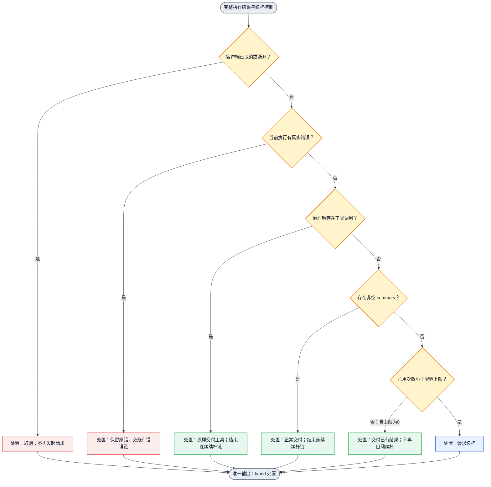
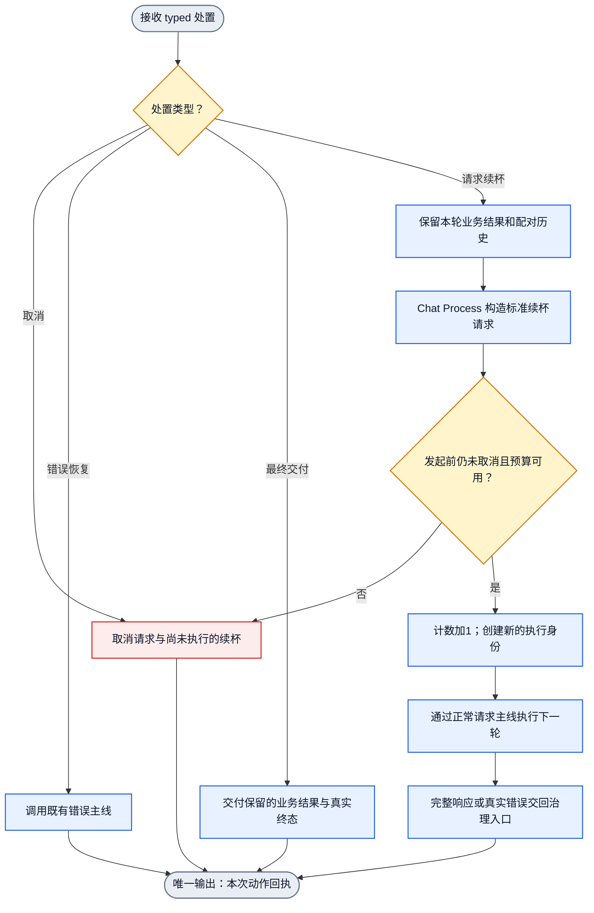
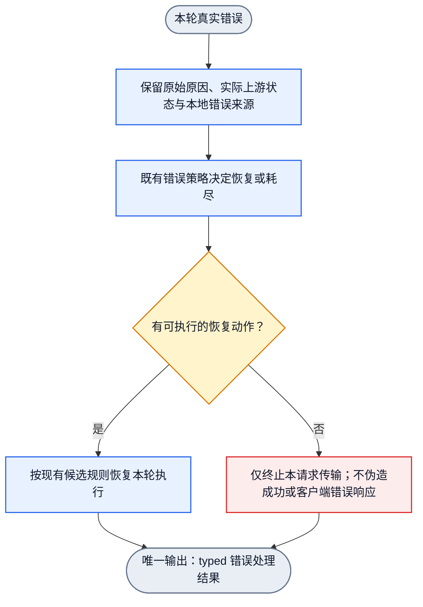

# Chat Process 有界续杯 DAG（待用户审计）

状态：设计草案。仅画图，不实施、不改 gate、不运行新策略、不安装或重启。权威工作项：66301e2。后续须经用户审计后再推进。

## 目标与边界

整次响应经过 Chat Process 治理后，同时满足「非工具调用、非错误、没有 summary」，且未达到连续续杯上限，才发起一次续杯。默认上限为1；0关闭；N表示最多新增N次续杯，不含原始请求。短会话可能多执行一次，这是用户明确接受的有限成本。

Chat Process 是唯一策略 owner。Direct 注册 hook 与 Relay Chat Process 复用同一个判断，不分别按协议实现策略。协议适配只提供标准事实、投影请求与响应。

不伪造 echo 工具、不将 finish reason 改成 tool_calls、不把真实错误改成续杯、不引入旧 Stopless/MetadataCenter 状态机。每次执行的真实结束原因均保留。续杯是声明的新请求，不是错误重试。

## 图一：完整响应的续杯决策

本图输入是「一次完整执行的治理结果＋本请求 typed 续杯控制」，输出是一个统一处置。错误、工具、summary、关闭、耗尽均有明确出口。

错误判断只消费本次执行的 typed 错误，不能从上一次失败日志、残留 finish reason 或正文猜测。错误链候选恢复成功后，新成功结果重新接受本图判断；未恢复的错误不续杯。

## 图二：一次续杯的请求与交付

本图输入是一次 typed 处置，输出是统一运行回执。一次调用只执行一次动作；下一次响应的判断由 Runtime 外层状态机发起，图内无回边。

构造请求时保留原请求、工具声明、原有历史、本轮 assistant 内容及工具结果配对。增加一条显式续杯指令，建议文案：「继续执行尚未完成的任务；需要工具时直接调用工具；如果任务已完成，请给出完成总结。」这条指令是新声明的产品行为，不从业务 metadata 偷渡控制状态。

中间响应不提前发送客户端完成事件。它的业务内容必须保留在续杯历史及最终可交付结果中；不得只保留日志，也不得静默丢弃。原有全 attempt buffering 仍成立。最终交付前需要标准内容累积／投影边，以保留前序文本和最终工具调用；不能只覆盖成最后一轮正文。该边目前为拟新增设计，未实现。

## 图三：续杯中的错误恢复

错误对象独立进入既有 Error 图；续杯策略不判断 provider 健康、不承担候选切换。

同一轮的 provider 候选切换不重复扣续杯次数。次数在新续杯执行真正发起时增加。恢复失败不回到「无 summary」分支，原错不得被改为502空响应或正常完成。

## 配置与计数合同（拟定）

用户已指定配置唯一位置：`v3/crates/routecodex-v3-config/src/internal.toml` 的 `[chat_process.refill]`，字段 `max_consecutive_refills = 1`，非负整数，0关闭。由 `internal.rs` 解析并发布 typed 只读策略，不新增用户 `config.toml`、server override 或环境变量配置面。该文件目前是编译期嵌入资产，修改后须重建并加载 binary，不宣称热更新。当前尚未添加产品配置字段。

| 上限 | 一条连续无工具、无错误、无 summary 的链 |
|---|---|
| 0 | 原请求后直接交付；新增0次 |
| 1（默认） | 原请求 → 续杯1 → 仍不满足则交付；新增最多1次 |
| 3 | 原请求 → 续杯1 → 续杯2 → 续杯3 → 交付；新增最多3次 |

计数只属于当前客户端请求的 typed Runtime 控制资源。新客户端请求从0开始。工具调用／summary 使当前自动链结束；客户端执行工具后发来的新请求是新链。并发会话、不同端口不共享计数。错误恢复不会重置已有预算。客户端取消后不再发起后续请求。

上限耗尽不是 provider 错误。不因此触发冷却、切 provider、生成错误号或补一个 stop。交付已经取得的真实业务结果及终态；该终态只证明响应结束，不证明整个开发任务完成。

## Owner 与已确认缺边

| 职责 | 当前定位／拟新增边 |
|---|---|
| 完整治理后策略判断 | `v3/crates/routecodex-v3-runtime/src/hub_v1/resp_chat_process_03_governed.rs`；拟新增共享判断，不按协议重复 |
| Direct 消费同一治理策略 | 已注册 Direct hook 边；拟传递相同 typed 决策，不自行重写判断 |
| 配置解析与发布 | `internal.toml` → `internal.rs` typed 只读策略 → Chat Process；唯一配置源，拟新增非负整数 |
| 预算、执行身份、取消与下一轮启动 | Runtime；消费 Chat Process 决策，不能在 Provider/SSE 层自行续杯 |
| 请求历史与续杯指令 | 请求 Chat Process；通过正常 Request 图重新进入 |
| 错误分类与候选恢复 | 既有 Error 主线；不新增续杯专属错误捷径 |
| 内容保留与最终交付 | Runtime 保留完整业务结果，标准投影/SSE 负责最终表达；拟补累积边 |

已确认：现有 `FollowupRequired` 主要表达 servertool 需要后续动作，不能把它当作已存在的通用自动续杯执行器。图中的通用 Runtime followup 接线尚未实现，现有实际续跑主要绑定具体 web-search 路径。只改标记不会交付本功能。

原 request/response/error 图各自闭合，但没有本功能需要的「完整治理 → typed 续杯决策 → 标准请求构造 → Runtime 新执行 → 内容累积 → 最终交付」完整接线。本草案先暴露这些缺边，不冒充当前已实现图。

## 审计须明确的语义

1. `summary` 检查：拟使用标准 Chat Process 提供的显式非空 summary 事实；空数组、空字符串和纯空白不计入。不用正文关键词或长度猜总结。`reasoning.summary` 与正文完成总结不能混称，具体映射仍须审计确认。
2. 原因保真：没有 Chat finish_reason 的 Responses completed 不因此判错；不把 length/content_filter 等真实非stop终态改成stop。它们是否触发续杯由本功能明确的非工具／非错误／无summary条件决定，不能隐式另加终态例外。
3. 业务内容保留：前序正文与最终工具调用怎样在标准响应中完整交付，是必需接线，不允许丢掉前序正文来简化实现。

## 图审计后的最小验收（本轮不执行）

- 上限0、默认1、配置3分别断言实际新增请求次数0/1/3。
- 有工具、有非空summary、真实错误分别不进入续杯分支。
- 无summary→续杯→真实工具调用：客户端实际执行工具并完成配对后续请求。
- 续杯错误进入既有错误链，原原因不变；provider切换不增加续杯计数。
- 并发请求、不同端口计数独立；取消后不再发起续杯。
- Direct与Relay使用同一策略；前序文本、工具身份、参数、call ID和真实终态完整保留。

三张展示图均为单入口、统一处置／回执出口；不包含回边。当前仅为待审计 Mermaid 业务设计，尚未注册为可执行 DAGPipe 图，未声称 operator绑定、代码接线或黑盒通过。用户审计前不进行这些后续工作。
