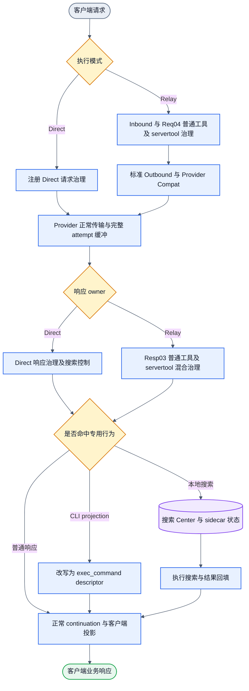
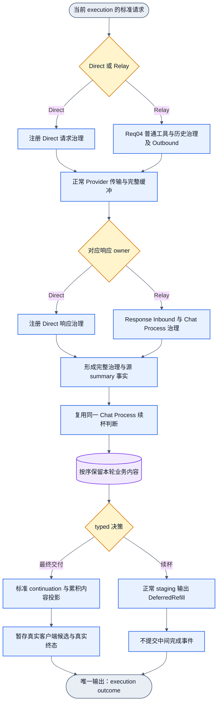
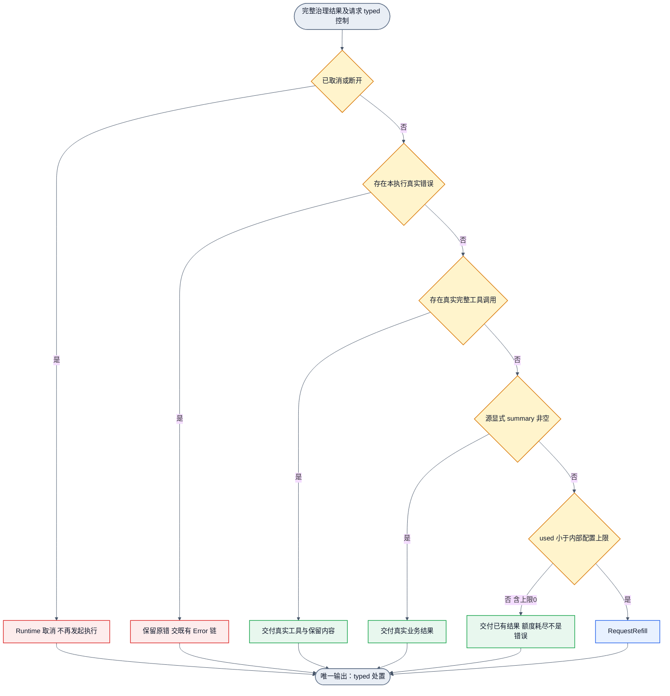
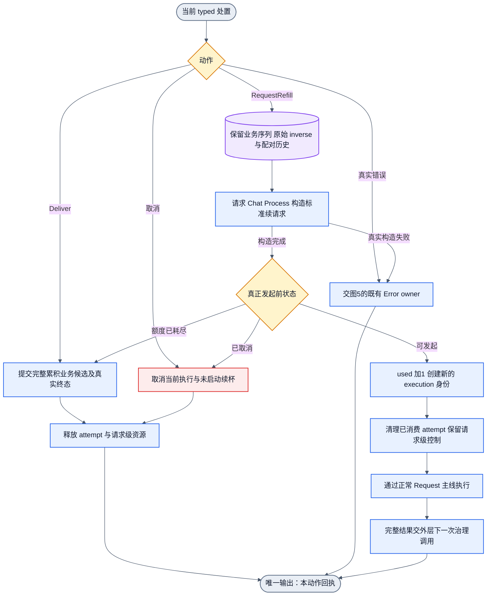
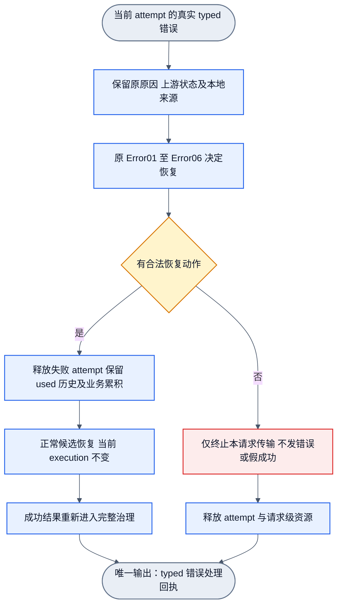
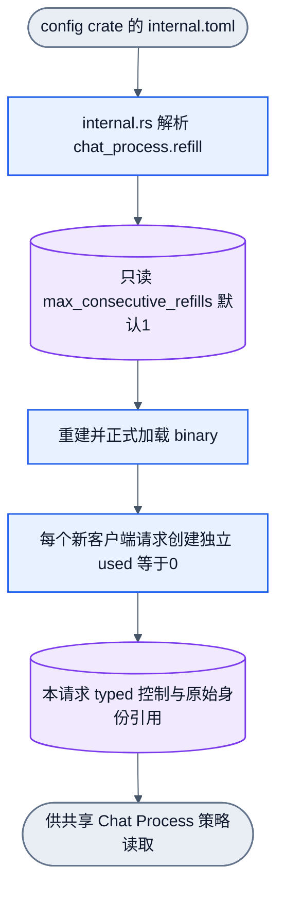

# 66301e2：Servertool 移除与有界续杯整合 DAG

状态：整合设计，未修改或注册活动 graph.json，未实施运行接线。原 [bounded-refill DAG](66301e2-bounded-refill-dag.md) 保留不改；续杯语义按该原设计和本次用户指令执行。详细合同见 [整合方案](66301e2-servertool-refill-integrated-plan.md)。

## 1. 改造前：专用 servertool 接线

这是一次成功 Provider 业务响应所在的当前主线责任视图，不包括 Error 对象源。图上的 servertool FollowupRequired 是现有标记，不代表通用有界续杯执行器已运行。

此外，当前静态目标合同还有 servertool_sidecar_plan、servertool_followup和空candidate/reentry表述。它们必须与实际搜索专用接线一并清理，不能由本图推断通用refill已存在。

## 2. 改造后：一次执行产生统一处置

本图是一次完整执行的责任视图。成功候选与延期续杯在单一 typed outcome 处汇合。Runtime下一动作见图4，不在此图连回请求入口。Error与取消有独立对象源，见图3和图5。

共享判断属于Chat Process；Direct hook只提供标准事实和调用入口，不拥有另一份策略。图中的框是责任分组，不是新增大骨架节点或已编译Operator声明。固定response节点仍按次序运行。延期是typed处置，不是正常空成功帧。

## 3. 共享决策：按用户指定三条件与上限

该图输入是当前完整治理结果及当前请求typed控制。错误/取消由其现有owner处置；共享策略不改变真实终态、不判断provider健康。

不添加stop-only、长度、关键词、task/goal完成度或旧echo特殊终态例外。真正的治理后不可交付结果在原边界产生typed错误，不能借无summary进入续杯。空白/缺失summary不止链；RCC合成summary不是源summary。源字段必须先绑定provenance。

## 4. Runtime 单次动作与资源终点

本图每次只执行一个动作，下一次治理由Runtime外层状态机触发新的图调用。没有静态回边。attempt清理与request finalizer分开。

同一请求owner串行管理used，正常情况下策略判断后到发起前不会被另一个动作消耗；发起边仍按typed状态区分取消与正常额度耗尽。构造失败走真实错误，尚未发起不扣次数。Error恢复只增attempt身份，不增加refill计数。新客户端请求独立used=0。

## 5. Error 恢复与两种耗尽

错误对象独立进入原Error图。Error恢复不是续杯；失败恢复不再次占用续杯额度。已有前轮文本也不能变成失败后的假正常完成。

续杯额度耗尽在图3交付真实结果；本图候选耗尽中止请求。二者不混为一类，不把真实错误改成新续杯或新502原因。provider健康与冷却仍由原typed身份策略负责。

## 6. 配置源与请求隔离

这是配置到运行控制的辅助资源流，不是第四个业务对象源。唯一输入是config crate的内部配置，唯一输出是可供本请求策略使用的独立typed控制。

无用户config、server override、环境变量、运行时动态API或payload marker。配置值不存used；相同policy不意味着不同端口/会话共享运行次数。

## 7. 删除与补边总表

| 删除 | 保留/补齐 |
|---|---|
| 专用搜索 Center、sidecar、ExecuteWebSearch、CLI descriptor、vision_auto包装 | 标准原生搜索、普通本地工具、多模态、原有工具身份/历史 |
| servertool_sidecar_plan 与 servertool_followup语义 | 独立refill decision、request construction、execution origin和Runtime动作 |
| echo伪工具、auto_continue/listener开关方案 | internal.toml单一上限、源summary、请求隔离used |
| 把empty candidate视为成功或让续杯绕过主线 | DeferredRefill typed staging、完整内容序列、最后标准投影与commit |
| 搜索专用资源清理 | attempt清理、request finalizer、取消和Error恢复各自scope |

六图都是单次有限对象流/责任视图；不表示已注册或已编译的DAGPipe图。运行时重复调用不同图属于生命周期调度，不能画静态回边。图1/2用于前后对照，图3/4定义新能力，图5保留原错误边界，图6定义唯一配置源。

## 8. 查看图与本轮检查

正文Mermaid是设计正文的一部分；以下图源和SVG由正文派生，后续修改正文后重新导出，不独立维护第二份语义。

| 图 | SVG | Mermaid 源 |
|---|---|---|
| 改造前 | [01-before.svg](66301e2-servertool-refill-diagrams/01-before.svg) | [01-before.mmd](66301e2-servertool-refill-diagrams/01-before.mmd) |
| 改造后 | [02-after.svg](66301e2-servertool-refill-diagrams/02-after.svg) | [02-after.mmd](66301e2-servertool-refill-diagrams/02-after.mmd) |
| 续杯决策 | [03-refill-decision.svg](66301e2-servertool-refill-diagrams/03-refill-decision.svg) | [03-refill-decision.mmd](66301e2-servertool-refill-diagrams/03-refill-decision.mmd) |
| Runtime动作 | [04-runtime-action.svg](66301e2-servertool-refill-diagrams/04-runtime-action.svg) | [04-runtime-action.mmd](66301e2-servertool-refill-diagrams/04-runtime-action.mmd) |
| Error与清理 | [05-error-cleanup.svg](66301e2-servertool-refill-diagrams/05-error-cleanup.svg) | [05-error-cleanup.mmd](66301e2-servertool-refill-diagrams/05-error-cleanup.mmd) |
| 配置与隔离 | [06-config-isolation.svg](66301e2-servertool-refill-diagrams/06-config-isolation.svg) | [06-config-isolation.mmd](66301e2-servertool-refill-diagrams/06-config-isolation.mmd) |

本轮检查：六张图均经Mermaid CLI成功渲染；前图、后图和续杯决策另导出PNG并查看，文字和箭头可读。只读拓扑检查确认六个展示视图均无环、各有唯一入口和出口；mmd源与正文一致。文档本地链接、代码围栏、相关npm脚本名和公开测试target所属crate已核对。

这些检查不等于项目DAGPipe gate、Operator编译或产品运行验收。活动graph.json、internal.toml、requirements及产品源码均未修改，原三份bounded-refill设计保留。
