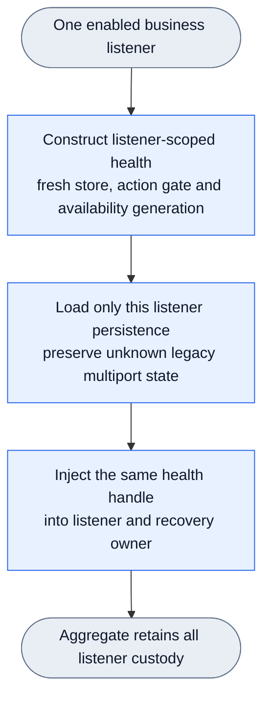
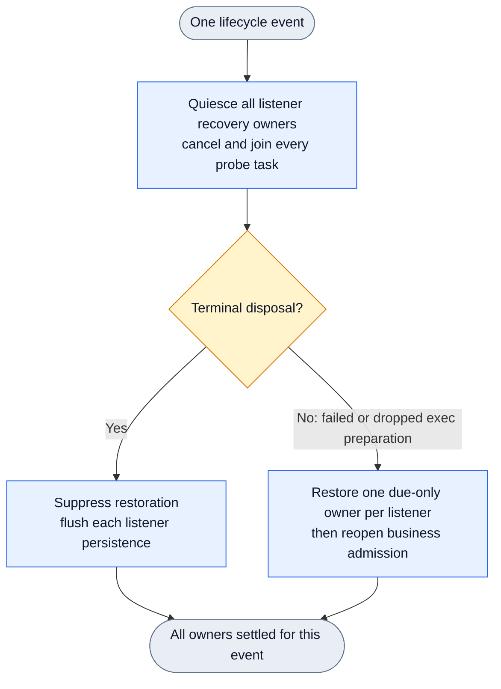

# Port-local provider health

Requirement: routecodex-port-local-provider-health v1. Candidate source only; no install, review or delivery claim. The construction DAG is graph-stage documentation, not a claim of new SDK operators registered in the runtime. It binds the existing owners below.

Bindings: Server `spawn_v3_server_aggregate_with_admin_and_hooks_sidecar_socket` creates `V3ProviderHealthListenerScope` and `V3ResponsesRelayProviderHealthHandle::from_manifest_for_listener`; Runtime `V3ProviderFailureRuntimeHealth::from_manifest_for_listener` creates its fresh action gate; Provider `V3ProviderHealthStore::from_manifest_for_listener` owns state and paths. Server `AggregateProbeLifecycle` retains `ListenerProbeOwners`; quiesce joins all, rollback restores all, terminate/drop suppress restoration. Provider persistence pruning owns only the matching listener suffix. Explicit override selects a directory for independent files in multi-listener mode; single-listener path compatibility remains. Old multiport state with unknown port origin is preserved and never seeded into all listeners.

Public gate: `npm run test:v3-port-local-provider-health`. Six tests cover failure/probe isolation, exact key/model identity, default and explicit-override rebuild isolation and recovery, and all-owner lifecycle rollback. Real failure tests have an eligible spare candidate. Rebuild tests keep the same ports but disable HTTP idle pooling so reads reach the new aggregate; old accepted connections surviving listener shutdown are not a Provider persistence failure. No weaker timeout, cooldown clearing or provider substitution is used.

Independent readonly diagnosis: /private/tmp/rcc-provider-policy-run/d9-persistence-astra-result.md. Initial three public RED failures and final five GREEN results are retained in d9-run/events.jsonl. This issue does not implement last-candidate terminal policy (86b45e0) or client connection adoption (6bb0153), and does not change business payloads.
